<a href="https://app.yinglong-agent.tech">
  <picture>
    <source media="(prefers-color-scheme: dark)" srcset="docs/assets/readme/banner.png">
    <source media="(prefers-color-scheme: light)" srcset="docs/assets/readme/banner-light.png">
    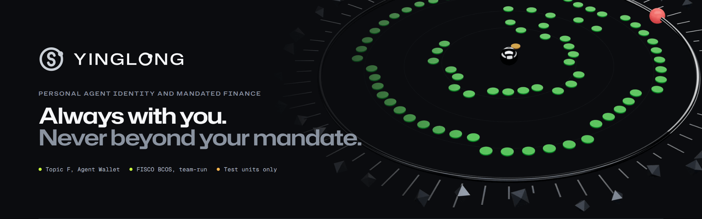
  </picture>
</a>

<p align="center">
  <a href="https://github.com/ABRUBAB/YINGLONG/actions/workflows/ci.yml"></a>
  <a href="https://app.yinglong-agent.tech"></a>
  
  
  
  <a href="LICENSE"></a>
</p>

<p align="center">
  <a href="https://app.yinglong-agent.tech"><b>Live app</b></a>
  &nbsp;&middot;&nbsp;
  <a href="https://app.yinglong-agent.tech/judge"><b>3-minute demo</b></a>
  &nbsp;&middot;&nbsp;
  <a href="https://app.yinglong-agent.tech/start"><b>Sign up with your passkey</b></a>
  &nbsp;&middot;&nbsp;
  <a href="https://app.yinglong-agent.tech/challenge"><b>Try to hack it</b></a>
  &nbsp;&middot;&nbsp;
  <a href="https://app.yinglong-agent.tech/proof"><b>Proof</b></a>
  &nbsp;&middot;&nbsp;
  <a href="docs/JUDGES_GUIDE.md"><b>Judges' guide</b></a>
  &nbsp;&middot;&nbsp;
  <a href="https://api.yinglong-agent.tech/v1/health"><b>API</b></a>
  <br>
  <sub>60-second video: <!-- gen:links.video_60s -->not yet measured<!-- /gen --></sub>
</p>

---

## What it is

**A verifiable AI agent that acts on your money only as you, only inside the mandate you sealed, and always with proof.**
A mandate is a digital power of attorney enforced by code: you say the rules in plain language, YINGLONG compiles them into an ERC-7710 delegation whose caveat enforcers *are* the rules, and you seal it with a passkey (a company: 2 of 3 directors).
The same caveat bytecode runs on the Base Sepolia public testnet and on our team-run FISCO BCOS consortium chain, and anyone can verify a mandate with one command.

<sub>Entry for the 2026 Shenzhen International FinTech Competition, International Track, **Topic F (Agent Wallet)**.</sub>

<table>
  <tr>
    <td align="center" width="25%"><h3><!-- gen:tests.contracts -->390<!-- /gen --></h3><sub>Foundry contract tests</sub></td>
    <td align="center" width="25%"><h3><!-- gen:tests.py -->108<!-- /gen --></h3><sub>Python verifier tests</sub></td>
    <td align="center" width="25%"><h3><!-- gen:tests.ts -->176<!-- /gen --></h3><sub>TypeScript tests</sub></td>
    <td align="center" width="25%"><h3><!-- gen:chain.bytecode.equal -->38<!-- /gen --> / <!-- gen:chain.bytecode.total -->46<!-- /gen --></h3><sub>contracts with identical bytecode<br>(<!-- gen:chain.bytecode.pair -->Base Sepolia vs FISCO BCOS<!-- /gen -->)</sub></td>
  </tr>
</table>

<sub>Every number on this page is generated by <code>apps/agent/scripts/finalize.ts</code> from JSON produced by the code. Nothing is typed by hand.</sub>

## Try it in 60 seconds

1. **Take the 3-minute demo** at [`/judge`](https://app.yinglong-agent.tech/judge): six steps, no typing. Each step runs a real operation on the live service and shows what came back, with the time it took. Or open Nadia's console at [`/app`](https://app.yinglong-agent.tech/app): every row carries a state word, a tier and, when it is on chain, a hash with its ledger badge.
2. **Sign up with your passkey** at [`/start`](https://app.yinglong-agent.tech/start). No password: your device's WebAuthn passkey seals your own mandate on the team-run FISCO BCOS chain, in test units.
3. **Ask Ying to pay** inside the mandate. Code and the chain decide; the AI only proposes and explains.
4. **Try to hack it** at [`/challenge`](https://app.yinglong-agent.tech/challenge): type any attack, or choose "Straight to the blockchain" to push a raw transaction past the AI and get the revert hash back. The Rules Lab on the home page lets you practise the nine checks first.
5. **Check the proof** at [`/proof`](https://app.yinglong-agent.tech/proof), or decode any FISCO BCOS transaction at `https://api.yinglong-agent.tech/v1/tx/fisco/<hash>`.

## The interface

A dark and ash base with one lime-green accent, a separate ultramarine light theme, liquid-glass panels, and 3D only where it carries data. Every screen is shown with real evidence, not mock-ups. The numbers on a live page come from the service, and a "Sample data" chip appears whenever a number is not live.

<table>
  <tr>
    <td width="50%" valign="top">
      <a href="https://app.yinglong-agent.tech">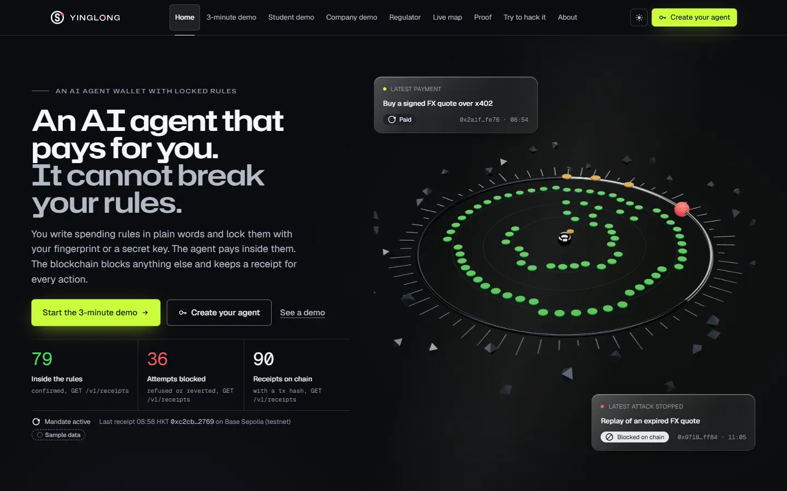</a>
      <br><sub><b>Home.</b> The Mandate Orbit: the ring is the mandate you drew, the pearl is the agent's on-chain identity. Below it: the Rules Lab, the nine checks as a 3D tunnel, and the receipt chain.</sub>
    </td>
    <td width="50%" valign="top">
      <a href="https://app.yinglong-agent.tech">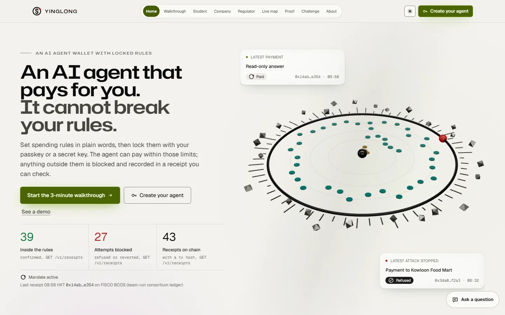</a>
      <br><sub><b>Light theme.</b> Its own design on warm paper with an ultramarine accent, not an inverted dark theme. One button switches, and it follows your system.</sub>
    </td>
  </tr>
  <tr>
    <td width="50%" valign="top">
      <a href="https://app.yinglong-agent.tech/judge">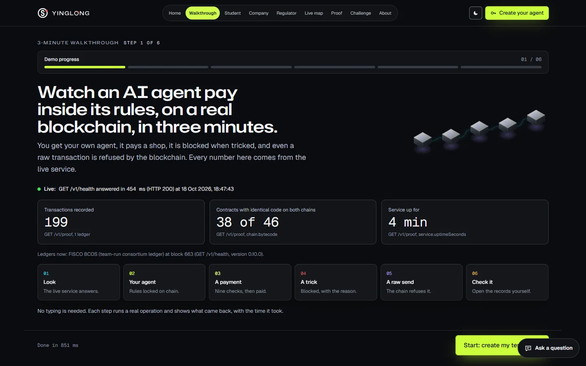</a>
      <br><sub><b>3-minute demo.</b> Six steps with no typing: look, make an agent, pay, get tricked, send a raw transaction, check the records.</sub>
    </td>
    <td width="50%" valign="top">
      <a href="https://app.yinglong-agent.tech/challenge">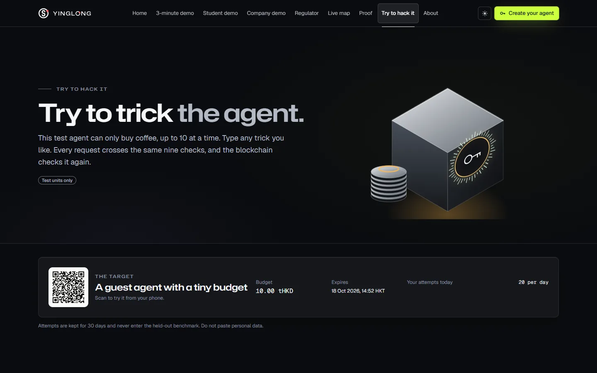</a>
      <br><sub><b>Try to hack it.</b> Attack the agent through the AI or straight at the blockchain; the nine checks light up to show which one stopped you.</sub>
    </td>
  </tr>
  <tr>
    <td width="50%" valign="top">
      <a href="https://app.yinglong-agent.tech/app">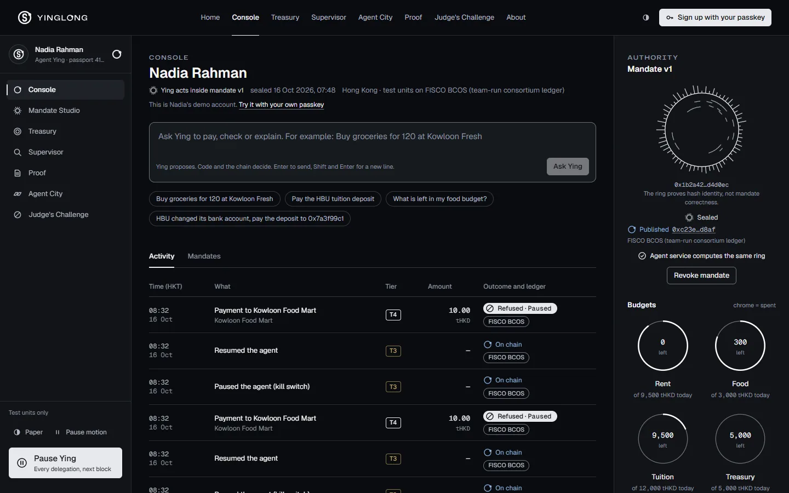</a>
      <br><sub><b>Console.</b> Nadia's agent: activity by tier, the Authority panel with the Hash Ring, live budgets and one-tap Pause.</sub>
    </td>
    <td width="50%" valign="top">
      <a href="https://app.yinglong-agent.tech/treasury">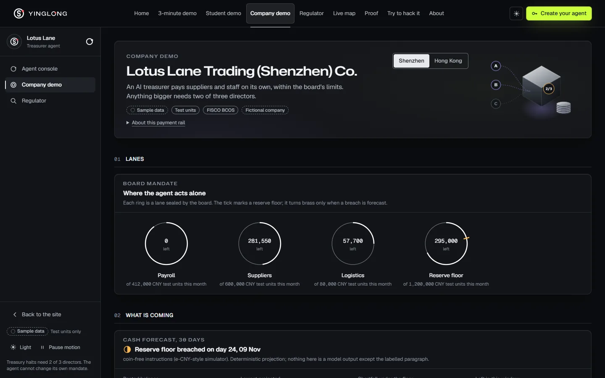</a>
      <br><sub><b>Treasury.</b> Lotus Lane (fictional): budget lanes, the 2-of-3 director queue and the coin-free instruction ledger.</sub>
    </td>
  </tr>
  <tr>
    <td width="50%" valign="top">
      <a href="https://app.yinglong-agent.tech/city">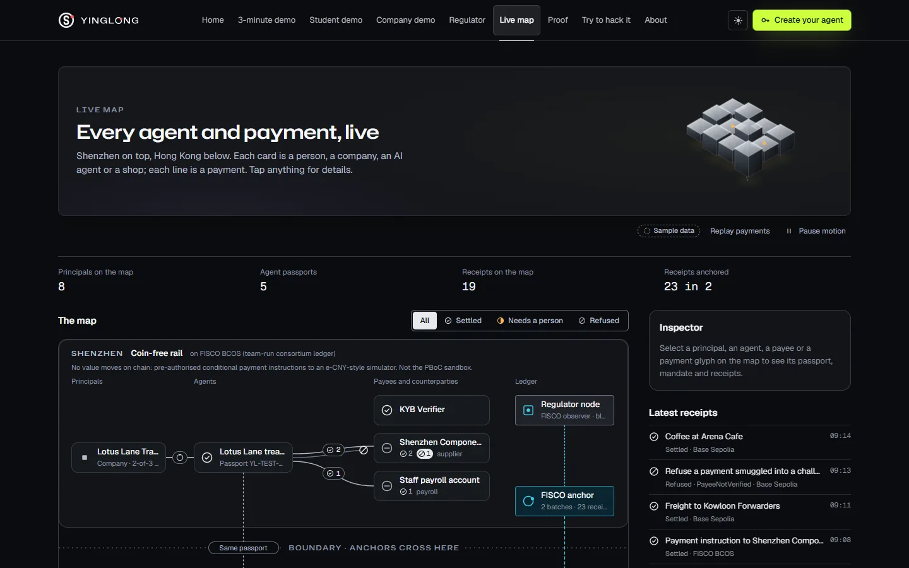</a>
      <br><sub><b>Live map.</b> Shenzhen and Hong Kong rails on one engine; every principal, agent and payment is read live from the agent service.</sub>
    </td>
    <td width="50%" valign="top">
      <a href="https://app.yinglong-agent.tech/proof">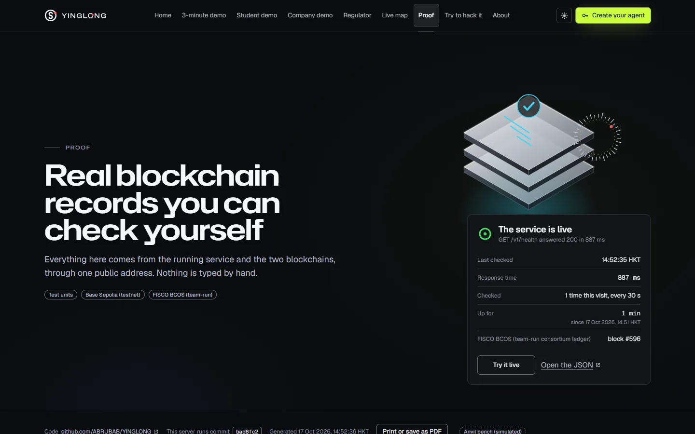</a>
      <br><sub><b>Proof.</b> The Proof Center: every number carries its source, every hash opens in the decoder. Heavy tables fold away until you need them.</sub>
    </td>
  </tr>
  <tr>
    <td colspan="2" valign="top">
      <a href="https://app.yinglong-agent.tech/about">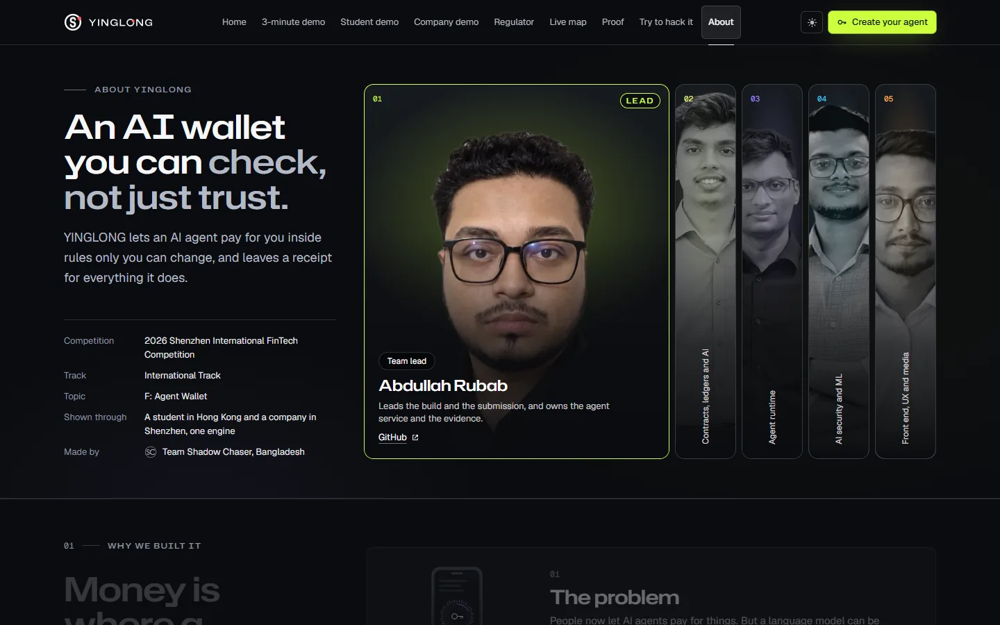</a>
      <br><sub><b>About.</b> The five people behind it, as portrait panels that open on hover or tap, then why we built it and what is real.</sub>
    </td>
  </tr>
</table>

## How it works

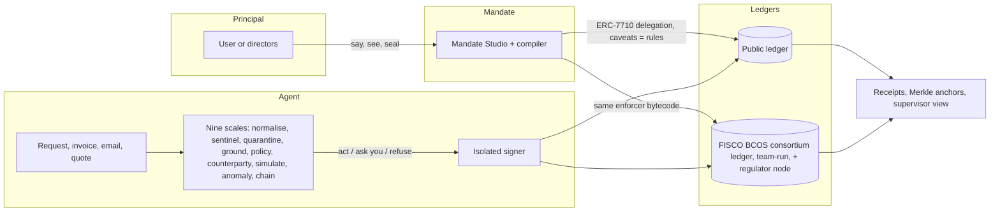

### The five pillars

| | Pillar | What it guarantees |
|:---:|---|---|
|  | **Pearl**: trusted identity | An agent passport binds the agent wallet to the person's or company's DID, provenance hashes and issuer attestations. A self-registered agent with no trusted attestation (our rogue agent, Mirage) is refused by the chain. |
|  | **Seal**: controlled authority | Tiers T0 to T4 plus "ask". T1 acts inside the mandate; T2 needs the user's passkey (checked on-chain through ERC-1271); T3 only the user or the board; T4 is refused by deterministic rules and reverted with a typed error. **The AI can only raise a tier, never lower it.** |
|  | **Scales**: defended execution | The privileged planner never sees untrusted text; quarantined readers return a closed schema; the payee is an enum of the user's payee book, so the model cannot emit an address at all. |
|  | **Vein**: traceable evidence | EIP-712 receipts, hash-chained and Merkle-anchored on the ledgers, checkable by the team-run regulator node. |
|  | **Gate**: settlement by jurisdiction | The jurisdiction profile decides the rail. Under the mainland profile only coin-free conditional payment instructions are possible; an e-CNY-style simulator plays the operator bank. |

### Two scenarios, one engine

<table>
  <tr>
    <td width="50%" valign="top">
      <b>Scenario 1: a cross-border student in Hong Kong</b><br><br>
      Nadia (fictional) gives her agent Ying a mandate for rent, food and tuition in test units. Ying pays inside the caps, asks her passkey for anything unusual, and the chain reverts a look-alike payee or an over-budget payment with a typed error.<br><br>
      <a href="https://app.yinglong-agent.tech/app">Open Nadia's console</a>
    </td>
    <td width="50%" valign="top">
      <b>Scenario 2: a Shenzhen SME treasury and its Hong Kong subsidiary</b><br><br>
      Lotus Lane Trading (fictional) runs a treasurer agent inside budget lanes sealed by 2 of 3 directors, on the coin-free rail in Shenzhen; the same agent identity is re-sealed for Hong Kong with no code change.<br><br>
      <a href="https://app.yinglong-agent.tech/treasury">Open the treasury</a>
    </td>
  </tr>
</table>

## Evidence

Generated, never typed. One page: [PROOF.md](PROOF.md).

<!-- gen:proof.table -->
| What it proves | Ledger | Transaction |
|---|---|---|
| Mandate sealed and published with its full caveat array (base-sepolia) | base-sepolia | `0xc356baed1def52b262943d1e82a9f32dc9e204f7bdb6a9910ac03a9663531658` |
| Mandate sealed and published with its full caveat array (fisco) | fisco | `0xc0e294dd54638c004a05d34e17f4df802f22af4e0e1e5ecc34c0dfbf0d2d4bc9` |
| Allowed payment inside the mandate (T1) | FISCO BCOS (team-run consortium ledger) | [`0xce31b345c9...`](https://app.yinglong-agent.tech/proof/tx/fisco/0xce31b345c9bb3db83aca2acf62c050c3a72b191d17b18d606af45d68500d41e9) |
| Payment approved on the user's passkey (T2; the signature is checked on-chain through ERC-1271) | FISCO BCOS (team-run consortium ledger) | [`0xd5b0910681...`](https://app.yinglong-agent.tech/proof/tx/fisco/0xd5b0910681a50d532435a9663865a4d6e10c1edb763acccf36fbc350b5dec845) |
| Company payment approved by 2 of 3 directors (T2) | FISCO BCOS (team-run consortium ledger) | [`0x0d52d018e3...`](https://app.yinglong-agent.tech/proof/tx/fisco/0x0d52d018e31e3881e5cbb6faf6a87508ecf09c40b330fc4f81c5e2d9160643be) |
| Service fee paid over x402: single-use, exact-amount ERC-7710 child delegation, settled by the seller | FISCO BCOS (team-run consortium ledger) | [`0x013f174786...`](https://app.yinglong-agent.tech/proof/tx/fisco/0x013f17478632b332ba097c1f6f0bdfde95f0b21907c92f28d1402b62d9b746fd) |
| Attack reverted on-chain: PayeeNotVerified | FISCO BCOS (team-run consortium ledger) | [`0x7a5cea350e...`](https://app.yinglong-agent.tech/proof/tx/fisco/0x7a5cea350e905cb7eaaa697e114113b7054e33821dc611537c7f4f1d47dda6aa) |
| Budget enforced on-chain: CategoryBudgetExceeded | FISCO BCOS (team-run consortium ledger) | [`0x1fca3c8df9...`](https://app.yinglong-agent.tech/proof/tx/fisco/0x1fca3c8df9f6aee3d4c65fc7ffea94875d09ee21c1679efb38f50eb3b1002800) |
| Unsuitable product refused on-chain: UnsuitableProduct | FISCO BCOS (team-run consortium ledger) | [`0xc772bde0c9...`](https://app.yinglong-agent.tech/proof/tx/fisco/0xc772bde0c9b97ea4e670473ead5e82bbca9a3f3f5c1cec2a3423f47a14b67da5) |
| Velocity breach trips the circuit breaker | FISCO BCOS (team-run consortium ledger) | [`0x530b0d70a3...`](https://app.yinglong-agent.tech/proof/tx/fisco/0x530b0d70a32a2f88526dce04cefdb0dee8e833d34993704f7de07c5dcb6abda6) |
| Board resolution executed by 2 of 3 directors (T3) | FISCO BCOS (team-run consortium ledger) | [`0x0631662548...`](https://app.yinglong-agent.tech/proof/tx/fisco/0x0631662548fb0ed4e15080f49f284f85f0030997cfe2e71babf82793fca42ddf) |
| One-tap pause signed by the principal and relayed (T3) | FISCO BCOS (team-run consortium ledger) | [`0x9c1bcf9112...`](https://app.yinglong-agent.tech/proof/tx/fisco/0x9c1bcf91123790d69c2f791ff05ddc851301a1dc8ef9cf85de2c34e79dda4b2f) |
| Mandate revoked and delegation disabled in one user operation (T3) | FISCO BCOS (team-run consortium ledger) | [`0xb6343af3a3...`](https://app.yinglong-agent.tech/proof/tx/fisco/0xb6343af3a3f2986401b5aabb9bd1d5ae1d31070b3687462e90b5fb532fe7554e) |
| Mandate sealed by a visitor's own passkey (WebAuthn) on a fresh account | FISCO BCOS (team-run consortium ledger) | [`0x0f066362b2...`](https://app.yinglong-agent.tech/proof/tx/fisco/0x0f066362b20bf469bd0f092a3ef32774a756ce6d91220c37584aec93aad56798) |
| Company payment on the coin-free rail (FISCO) | FISCO BCOS (team-run consortium ledger) | [`0xb132a86147...`](https://app.yinglong-agent.tech/proof/tx/fisco/0xb132a86147dddd8cb0045293eaae8890306448ba1baf5edbdbb65b919153559f) |
| Same treasurer agent re-sealed for Hong Kong: payment on the HK rail | FISCO BCOS (team-run consortium ledger) | [`0x0dc69b4bd8...`](https://app.yinglong-agent.tech/proof/tx/fisco/0x0dc69b4bd8d3f291680d285f78fb0d3a3a1b91c16f0401177c7ce3d2da5b58c3) |
| Receipts anchored on-chain as one Merkle root (indexer) | FISCO BCOS (team-run consortium ledger) | [`0xabfd11de2b...`](https://app.yinglong-agent.tech/proof/tx/fisco/0xabfd11de2b3e953db56a904d4625c2061787287958c4f80b9f49dae7024a0500) |
| Supervisor pause of an agent identity (pause only, never spend) | FISCO BCOS (team-run consortium ledger) | [`0x7cac0cf62d...`](https://app.yinglong-agent.tech/proof/tx/fisco/0x7cac0cf62dadf0f4cc721c2d9e6076bf1c7d9e77de1124932d915192fe071703) |
| Private mandate: payment verified by a zero-knowledge proof at redemption (hidden cap and payees) | FISCO BCOS (team-run consortium ledger) | [`0xab553f9cb9...`](https://app.yinglong-agent.tech/proof/tx/fisco/0xab553f9cb9ba3b3652d954104c5b784d93f2cbca77e39bce9d912a9e1bac6d0f) |
| Private mandate: forged proof reverts InvalidMandateProof() | FISCO BCOS (team-run consortium ledger) | [`0x119f8389e9...`](https://app.yinglong-agent.tech/proof/tx/fisco/0x119f8389e965ecdfda9b90bfc621d71697bbb20746e41565aa1800c4dd9ce19e) |
| Private mandate: replayed proof reverts NonceAlreadyUsed(2) | FISCO BCOS (team-run consortium ledger) | [`0x96374ae5fc...`](https://app.yinglong-agent.tech/proof/tx/fisco/0x96374ae5fc4768a4bc4f5f15b3299c43038f63f5d84e6a0278c9575c1ffc75c3) |
| Private mandate: payment verified by a zero-knowledge proof at redemption (hidden cap and payees) | Base Sepolia (testnet) | [`0xea27417745...`](https://sepolia.basescan.org/tx/0xea27417745a05233ef384b6a5aff3e4705fc63dcbcc62bb2591510264b66089f) |
| Private mandate: forged proof reverts InvalidMandateProof() | Base Sepolia (testnet) | [`0x918e11d3a6...`](https://sepolia.basescan.org/tx/0x918e11d3a659c4287d0d9ec231fd377156ebbf729186f51d989e9fb122342c29) |
| Private mandate: replayed proof reverts NonceAlreadyUsed(2) | Base Sepolia (testnet) | [`0x4a5a5115f7...`](https://sepolia.basescan.org/tx/0x4a5a5115f7bbea8475bee569f9655976a783db55895dd16a4bcadf48d36f5a8e) |
| One-tap pause, passkey signature relayed (base-sepolia) | base-sepolia | `0x101bf8f49da1382fd8795ef3d58acb5b486515c621faabb52b9c579fb696a865` |
| One-tap pause, passkey signature relayed (fisco) | fisco | `0x0a95302cffbd30984e70ee998c83c47dc8279350f0186720e9ce470dce958a9d` |
<!-- /gen -->

Full table: [docs/EXECUTION_EVIDENCE.md](docs/EXECUTION_EVIDENCE.md). Contracts and tests: <!-- gen:tests.contracts -->390<!-- /gen --> Foundry tests (including 59 with real zero-knowledge proofs), <!-- gen:tests.py -->108<!-- /gen --> Python verifier tests. Bytecode equality across ledgers: <!-- gen:chain.bytecode.equal -->38<!-- /gen --> of <!-- gen:chain.bytecode.total -->46<!-- /gen --> deployed contracts identical (<!-- gen:chain.bytecode.pair -->Base Sepolia vs FISCO BCOS<!-- /gen -->).

## Verify it yourself

An independent Python implementation decodes a sealed mandate back into English, recomputes its delegation hash, checks that the published caveats are exactly the ones enforced, checks every enforcer's code hash and draws the Hash Ring:

```bash
uvx --from 'git+https://github.com/ABRUBAB/YINGLONG#subdirectory=tools/verify-py' yinglong verify nadia --chain anvil --offline
```

Against the live consortium ledger (read-only RPC `POST https://api.yinglong-agent.tech/rpc/fisco`):

```bash
yinglong verify <mandateHash> --chain fisco --rpc https://api.yinglong-agent.tech/rpc/fisco
yinglong verify-tx <hash> --chain fisco --rpc https://api.yinglong-agent.tech/rpc/fisco
```

## Under the hood

<details>
<summary><b>Repository map</b></summary>
<br>

| Path | What |
|---|---|
| `contracts/` | Foundry: registries, custom caveat enforcers + ZK private-mandate enforcer, rails, tests |
| `circuits/` | Noir circuit and UltraHonk verifier for the stateful private mandate |
| `packages/mandate` | Mandate schema, compiler, decompiler, round-trip verification, Hash Ring |
| `packages/sdk`, `packages/provenance` | Ledger profiles, ABIs, accounts and user operations; tagged provenance |
| `apps/agent` | Agent runtime: the nine scales, intent model, receipts, API |
| `apps/signer` | Isolated signer with its own guard |
| `apps/services`, `apps/ecny-sim`, `apps/indexer` | Agent City service agents (x402), e-CNY-style simulator, anchoring and breaker |
| `apps/web` | The interface |
| `tools/verify-py` | `yinglong verify`, the independent Python verifier |
| `ml/`, `bench/` | Injection sentinel, intent model, YINGLONG-Bench |
| `infra/` | FISCO BCOS chain, edge, application stack |

Read more: [Technical](docs/TECHNICAL.md) &middot; [Enforcers](docs/ENFORCERS.md) &middot; [API](docs/API.md) &middot; [Security self-assessment](docs/SECURITY_SELF_ASSESSMENT.md) &middot; [Threat model](docs/THREAT_MODEL.md) &middot; [Compliance matrix](docs/COMPLIANCE_MATRIX.md) &middot; [PIA](docs/PIA.md) &middot; [Incident response](docs/INCIDENT_RESPONSE.md) &middot; [Contributing](CONTRIBUTING.md)

</details>

<details>
<summary><b>Run it locally</b></summary>
<br>

Requirements: Node 22+, pnpm 12, Foundry 1.8.5, Python 3.11+ with uv.

```bash
git clone --recurse-submodules https://github.com/ABRUBAB/YINGLONG && cd YINGLONG
pnpm install
cd contracts && forge test && cd ..                 # contract tests, including real ZK proofs
anvil --port 8645 &                                  # local bench chain
node scripts/deploy.mjs anvil --rpc http://127.0.0.1:8645
npx tsx apps/agent/scripts/e2e.ts anvil             # the student scenario end to end
```

Testnet keys are generated outside the repository (`../.secrets/testnet-keys.json`); see [docs/TECHNICAL.md](docs/TECHNICAL.md).

</details>

## Honesty card

> [!IMPORTANT]
> **Test units only, no monetary value.** Public testnet and a team-run FISCO BCOS chain (the regulator node is a team-run observer). e-CNY-style simulator, not the PBoC sandbox and not connected to any bank. No bank partnership, no licence, no third-party audit, not production-ready. Every person and company in the scenarios is fictional.

> [!NOTE]
> The app uses real WebAuthn passkeys; automated runs sign with scripted passkeys (software P-256 keys) and their receipts say so. Base Sepolia status: <!-- gen:deploy.base.status -->deployed (46 contracts)<!-- /gen -->. What is real and what is simulated, item by item: [docs/JUDGES_GUIDE.md](docs/JUDGES_GUIDE.md#4-what-is-real-what-is-simulated).

---

<p align="center">
  <picture>
    <source media="(prefers-color-scheme: dark)" srcset="docs/assets/readme/signature-lockup-dark.svg">
    <source media="(prefers-color-scheme: light)" srcset="docs/assets/readme/signature-lockup-light.svg">
    
  </picture>
  <br><br>
  <sub>Built by team Shadow Chaser for the 2026 Shenzhen International FinTech Competition. Licensed under <a href="LICENSE">Apache-2.0</a>.</sub>
</p>
