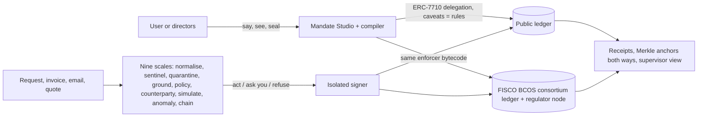

<p align="center"></p>

<h1 align="center">YINGLONG</h1>
<p align="center"><b>Personal Agent Identity &amp; Mandated Finance</b><br><i>Always with you. Never beyond your mandate.</i></p>

YINGLONG gives a person or a company a verifiable AI agent that can act on their money, but only as them, only inside the mandate they sealed, and always with proof. A mandate is a **digital power of attorney, enforced by code**: the user says the rules in plain language, YINGLONG compiles them into an ERC-7710 delegation whose caveat enforcers *are* the rules, the user seals it with a passkey (a company: 2 of 3 directors), and the **same enforcer bytecode** runs on a public chain and on a FISCO BCOS consortium chain. Every action, allowed or refused, leaves an accountability receipt anchored on the ledgers.

Entry for the **2026 Shenzhen International FinTech Competition, International Track, Topic F (Agent Wallet)**, proven through two deep scenarios on one engine: a cross-border student in Hong Kong and a Shenzhen SME treasury with its Hong Kong subsidiary.

| Try it | |
|---|---|
| Live app | https://app.yinglong-agent.tech |
| Judge's Challenge (attack the agent from your phone) | https://app.yinglong-agent.tech/challenge |
| Agent API | https://api.yinglong-agent.tech/v1/health |
| FISCO BCOS read-only RPC (regulator node) | `POST https://api.yinglong-agent.tech/rpc/fisco` |
| One-page proof | [PROOF.md](PROOF.md) |
| Judges' guide (what to click, what is simulated) | [docs/JUDGES_GUIDE.md](docs/JUDGES_GUIDE.md) |

## Verify it yourself in one command

An independent Python implementation decodes a sealed mandate back into English, recomputes its delegation hash, checks that the published caveats are exactly the ones enforced, checks every enforcer's code hash and draws the Hash Ring:

```bash
uvx --from 'git+https://github.com/ABRUBAB/YINGLONG#subdirectory=tools/verify-py' yinglong verify nadia --chain anvil --offline
```

Against the live consortium ledger (needs the read-only RPC above): `yinglong verify <mandateHash> --chain fisco --rpc https://api.yinglong-agent.tech/rpc/fisco`. Any transaction: `yinglong verify-tx <hash> --chain fisco`.

## Evidence (generated, never typed)

<!-- gen:proof.table -->
| What it proves | Ledger | Transaction |
|---|---|---|
| Mandate sealed and published with its full caveat array (fisco) | fisco | `0xc0e294dd54638c004a05d34e17f4df802f22af4e0e1e5ecc34c0dfbf0d2d4bc9` |
| Allowed payment inside the mandate (T1) | FISCO BCOS (team-run consortium ledger) | [`0xffc5d93002...`](https://app.yinglong-agent.tech/proof/tx/fisco/0xffc5d93002e1727750c1e0c1c8e28dee331f661b60a80803b973b10f8efcbc58) |
| Payment approved on the user's passkey (T2; the signature is checked on-chain through ERC-1271) | FISCO BCOS (team-run consortium ledger) | [`0xd5b0910681...`](https://app.yinglong-agent.tech/proof/tx/fisco/0xd5b0910681a50d532435a9663865a4d6e10c1edb763acccf36fbc350b5dec845) |
| Company payment approved by 2 of 3 directors (T2) | FISCO BCOS (team-run consortium ledger) | [`0x8f56db5b13...`](https://app.yinglong-agent.tech/proof/tx/fisco/0x8f56db5b13093d807ecf076d163090d8306e3b05cac30b521b6df761a7d2febc) |
| Service fee paid over x402: single-use, exact-amount ERC-7710 child delegation, settled by the seller | FISCO BCOS (team-run consortium ledger) | [`0x013f174786...`](https://app.yinglong-agent.tech/proof/tx/fisco/0x013f17478632b332ba097c1f6f0bdfde95f0b21907c92f28d1402b62d9b746fd) |
| Attack reverted on-chain: PayeeNotVerified | FISCO BCOS (team-run consortium ledger) | [`0x4610e08984...`](https://app.yinglong-agent.tech/proof/tx/fisco/0x4610e089843cf8072e5c11bac17266c794c9549b46fefb23b200a0e764ab25d2) |
| Budget enforced on-chain: CategoryBudgetExceeded | FISCO BCOS (team-run consortium ledger) | [`0x1fca3c8df9...`](https://app.yinglong-agent.tech/proof/tx/fisco/0x1fca3c8df9f6aee3d4c65fc7ffea94875d09ee21c1679efb38f50eb3b1002800) |
| Unsuitable product refused on-chain: UnsuitableProduct | FISCO BCOS (team-run consortium ledger) | [`0xc772bde0c9...`](https://app.yinglong-agent.tech/proof/tx/fisco/0xc772bde0c9b97ea4e670473ead5e82bbca9a3f3f5c1cec2a3423f47a14b67da5) |
| Velocity breach trips the circuit breaker | - | not yet recorded |
| Board resolution executed by 2 of 3 directors (T3) | FISCO BCOS (team-run consortium ledger) | [`0x6a63d19ebd...`](https://app.yinglong-agent.tech/proof/tx/fisco/0x6a63d19ebdc8f8667558cd06c1d2a41e033fd280eae02197805cc78adff65d08) |
| One-tap pause signed by the principal and relayed (T3) | FISCO BCOS (team-run consortium ledger) | [`0x98ffc2c3a3...`](https://app.yinglong-agent.tech/proof/tx/fisco/0x98ffc2c3a3bd8cdb4aa414a95231e3ae717ace8950af4ed4ec7d430d64dd0658) |
| Mandate revoked and delegation disabled in one user operation (T3) | FISCO BCOS (team-run consortium ledger) | [`0xb6343af3a3...`](https://app.yinglong-agent.tech/proof/tx/fisco/0xb6343af3a3f2986401b5aabb9bd1d5ae1d31070b3687462e90b5fb532fe7554e) |
| Mandate sealed by a visitor's own passkey (WebAuthn) on a fresh account | FISCO BCOS (team-run consortium ledger) | [`0x245e61b1f5...`](https://app.yinglong-agent.tech/proof/tx/fisco/0x245e61b1f59a311d4e5a682f9f43fbe3b78287a6bb355a12be64cdab0a4fba3c) |
| Company payment on the coin-free rail (FISCO) | FISCO BCOS (team-run consortium ledger) | [`0xd881e4d606...`](https://app.yinglong-agent.tech/proof/tx/fisco/0xd881e4d606a5616dbe18ceac6ecf752eeaa83ae431ec4714d76dcd328f941a71) |
| Same treasurer agent re-sealed for Hong Kong: payment on the HK rail | FISCO BCOS (team-run consortium ledger) | [`0x0dc69b4bd8...`](https://app.yinglong-agent.tech/proof/tx/fisco/0x0dc69b4bd8d3f291680d285f78fb0d3a3a1b91c16f0401177c7ce3d2da5b58c3) |
| Receipts anchored on-chain as one Merkle root (indexer) | FISCO BCOS (team-run consortium ledger) | [`0xabfd11de2b...`](https://app.yinglong-agent.tech/proof/tx/fisco/0xabfd11de2b3e953db56a904d4625c2061787287958c4f80b9f49dae7024a0500) |
| Supervisor pause of an agent identity (pause only, never spend) | FISCO BCOS (team-run consortium ledger) | [`0x7cac0cf62d...`](https://app.yinglong-agent.tech/proof/tx/fisco/0x7cac0cf62dadf0f4cc721c2d9e6076bf1c7d9e77de1124932d915192fe071703) |
| Private mandate: payment verified by a zero-knowledge proof at redemption (hidden cap and payees) | FISCO BCOS (team-run consortium ledger) | [`0xab553f9cb9...`](https://app.yinglong-agent.tech/proof/tx/fisco/0xab553f9cb9ba3b3652d954104c5b784d93f2cbca77e39bce9d912a9e1bac6d0f) |
| Private mandate: forged proof reverts InvalidMandateProof() | FISCO BCOS (team-run consortium ledger) | [`0x119f8389e9...`](https://app.yinglong-agent.tech/proof/tx/fisco/0x119f8389e965ecdfda9b90bfc621d71697bbb20746e41565aa1800c4dd9ce19e) |
| Private mandate: replayed proof reverts NonceAlreadyUsed(2) | FISCO BCOS (team-run consortium ledger) | [`0x96374ae5fc...`](https://app.yinglong-agent.tech/proof/tx/fisco/0x96374ae5fc4768a4bc4f5f15b3299c43038f63f5d84e6a0278c9575c1ffc75c3) |
| One-tap pause, passkey signature relayed (fisco) | fisco | `0x0a95302cffbd30984e70ee998c83c47dc8279350f0186720e9ce470dce958a9d` |
<!-- /gen -->

Full table: [docs/EXECUTION_EVIDENCE.md](docs/EXECUTION_EVIDENCE.md). Contracts and tests: <!-- gen:tests.contracts -->93<!-- /gen --> Foundry tests (including 59 with real zero-knowledge proofs), <!-- gen:tests.py -->105<!-- /gen --> Python verifier tests. Bytecode equality across ledgers: <!-- gen:chain.bytecode.equal -->39<!-- /gen --> of <!-- gen:chain.bytecode.total -->46<!-- /gen --> deployed contracts identical (<!-- gen:chain.bytecode.pair -->Anvil vs FISCO BCOS<!-- /gen -->).

## How it works



- **Pearl (trusted identity):** an agent passport binds the agent wallet to the person's or company's DID, to provenance hashes and to issuer attestations ("dual authorisation"). A self-registered agent with no trusted attestation (our rogue agent, Mirage) is refused by the chain.
- **Seal (controlled authority):** tiers T0 to T4 plus "ask", mapped to the three decision classes of China's 2026 agent guidance. T1 inside the mandate; T2 needs the user's passkey (checked on-chain through ERC-1271); T3 only the user or the board; T4 refused by deterministic rules and reverted by the chain with a typed error. **The AI can only raise a tier, never lower it.**
- **Scales (defended execution):** a privileged planner never sees untrusted text; quarantined readers return a closed schema; the payee is an enum of the user's payee book, so the model cannot emit an address at all.
- **Vein (traceable evidence):** EIP-712 receipts, hash-chained, Merkle-anchored on both ledgers, checkable by the regulator node.
- **Gate (compliant settlement):** the jurisdiction profile decides the rail; under the mainland profile only coin-free conditional payment instructions are possible (an e-CNY-style simulator plays the operator bank).

Details: [docs/TECHNICAL.md](docs/TECHNICAL.md) · [docs/ENFORCERS.md](docs/ENFORCERS.md) · [docs/API.md](docs/API.md) · [docs/SECURITY_SELF_ASSESSMENT.md](docs/SECURITY_SELF_ASSESSMENT.md) · [docs/THREAT_MODEL.md](docs/THREAT_MODEL.md) · [docs/COMPLIANCE_MATRIX.md](docs/COMPLIANCE_MATRIX.md) · [docs/PIA.md](docs/PIA.md) · [docs/INCIDENT_RESPONSE.md](docs/INCIDENT_RESPONSE.md) · [docs/CLAIMS.md](docs/CLAIMS.md)

## Run it locally

Requirements: Node 22+, pnpm 12, Foundry 1.8.5, Python 3.11+ with uv.

```bash
git clone --recurse-submodules https://github.com/ABRUBAB/YINGLONG && cd YINGLONG
pnpm install
cd contracts && forge test && cd ..                 # 89+ contract tests incl. real ZK proofs
anvil --port 8645 &                                  # local bench chain
node scripts/deploy.mjs anvil --rpc http://127.0.0.1:8645
npx tsx apps/agent/scripts/e2e.ts anvil             # the student scenario end to end
```

Testnet keys are generated outside the repository (`../.secrets/testnet-keys.json`); see `docs/TECHNICAL.md`.

## Repository

| Path | What |
|---|---|
| `contracts/` | Foundry: registries, 13 custom caveat enforcers + ZK private-mandate enforcer, rails, tests |
| `circuits/` | Noir circuit and UltraHonk verifier for the stateful private mandate |
| `packages/mandate` | Mandate schema, compiler, decompiler, round-trip verification, Hash Ring |
| `packages/sdk`, `packages/provenance` | Ledger profiles, ABIs, accounts and user operations; tagged provenance |
| `apps/agent` | Agent runtime: the nine scales, intent model, receipts, API |
| `apps/signer` | Isolated signer with its own guard |
| `apps/services`, `apps/ecny-sim`, `apps/indexer` | Agent City service agents (x402), e-CNY-style simulator, anchoring and breaker |
| `apps/web` | The interface (ORBIT design system) |
| `tools/verify-py` | `yinglong verify`, the independent Python verifier |
| `ml/`, `bench/` | Injection sentinel, intent model, YINGLONG-Bench |
| `infra/` | FISCO BCOS chain, edge, application stack |

## Honesty card

Test units only, no monetary value. Public testnet and a team-run FISCO BCOS chain. e-CNY-style simulator, not the PBoC sandbox and not connected to any bank. No bank partnership, no licence, no third-party audit, not production-ready. Automated runs sign with scripted passkeys (software P-256 keys) and are labelled as such; the app uses real WebAuthn passkeys.

---

<p align="center">A Shadow Chaser innovation.</p>
