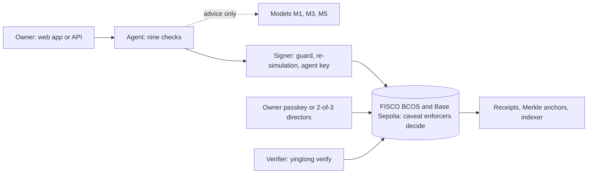

# YINGLONG System Architecture

*Technical documentation, part 1 of 3. Part 2 is [CORE_ALGORITHMS.md](CORE_ALGORITHMS.md) (the algorithms and models). Part 3 is [SECURITY_DESIGN.md](SECURITY_DESIGN.md) (the security design). The full reference, with every table and test, is [TECHNICAL.md](TECHNICAL.md).*

*2026 Shenzhen International FinTech Competition, International Track, Topic F (Agent Wallet). Team Shadow Chaser.*

---

## 1. What the system does, in one paragraph

An AI agent moves money for a person or a company only inside a **mandate** that the owner sealed. The mandate is an ERC-7710 delegation whose caveat enforcers *are* the rules, so the blockchain, not the model, has the last word. Every request passes nine ordered checks, only deterministic code can refuse, models can only make the agent more careful, and every action, allowed or refused, leaves a receipt that anyone can verify against two ledgers.

All value in the system is **test units** (`tHKD`, `tUSD`) or coin-free instructions. The mainland rail is an e-CNY-style simulator. The FISCO BCOS chain is run by the team. There is no audit, no bank partnership and no licence, and every screen says so.

## 2. Five pillars

| Pillar | The question it answers | Where it lives |
|---|---|---|
| **Pearl**, trusted identity | Who is this agent, and for whom does it act? | `YinglongPassportRegistry`, `AgentLineageEnforcer`, signed agent cards |
| **Seal**, controlled authority | What may it do, and who decided? | `packages/mandate`, `MandateRegistry`, `PayeeBook`, `KillSwitchRegistry`, the custom enforcers |
| **Scales**, defended execution | Can it be tricked or go rogue? | `apps/agent` (the nine checks), `apps/signer` |
| **Vein**, traceable evidence | Can anyone check what it did and why? | Receipts, `AccountabilityLedger`, `apps/indexer`, `tools/verify-py` |
| **Gate**, compliant settlement | Is it lawful where the owner lives? | `JurisdictionEnforcer`, the rails, `apps/ecny-sim` |

## 3. Layers of the system

| Layer | What is in it |
|---|---|
| Interface | The web app (home, start, mandate studio, console, approve, challenge, treasury, supervisor, city, proof, judge, about), the API under `/v1`, and the Python verifier |
| Agent | The nine checks; understanding with hosted Qwen, a fallback model and a rule parser; board proposals, approvals and receipts |
| Models (advisory only) | M1 injection sentinel, M3 behaviour anomaly, M5 cash-flow forecast, served by `ml/serving` |
| Signing | `apps/signer` (guard, re-simulation, the agent key); the owner's passkey or the 2-of-3 directors sign user operations |
| Ledgers | FISCO BCOS 3.17.1 (four sealers and one observer node, team-run) and Base Sepolia (public testnet) |
| Evidence | `apps/indexer` (Merkle batches, cross-anchors, breaker watcher, read-only RPC proxy), `apps/ecny-sim` (coin-free rail operator), `apps/services` (x402 sellers, agent cards, a rogue agent for tests) |

The deciding line is the arrow from the agent layer to the signing layer and then the ledgers: whatever the models say, the transaction only goes through if every caveat enforcer on the chain accepts it.

## 4. Components

| Component | Role | Entry point |
|---|---|---|
| `apps/web` | The interface: about a dozen pages, light and dark themes, passkey sign-up, approval page, live map, proof centre. Next.js 16, self-hosted fonts and assets. | `app/` |
| `apps/agent` | The HTTP API and the nine checks; approvals, board proposals, receipts, the public attack challenge | `src/server.ts`, `src/pipeline.ts` |
| `apps/signer` | The only process that holds agent keys. Listens on 127.0.0.1 only. Signs one kind of transaction (a redemption) after its own guard and a fresh simulation | `src/server.ts`, `src/guard.ts` |
| `apps/indexer` | Collects receipts, batches them into Merkle roots, anchors on every configured ledger, cross-anchors the ledgers to each other, trips the kill switch on a breaker rule, serves a read-only FISCO RPC proxy | `src/anchoring.ts`, `src/breaker.ts` |
| `apps/services` | Fictional service agents sold over x402 (FX quotes, business checks), signed agent cards, a rogue agent used only for tests | `src/app.ts`, `src/x402/*` |
| `apps/ecny-sim` | Plays the operator bank for the coin-free rail | `src/simulator.ts` |
| `packages/mandate` | Mandate schema, canonical JSON, compiler, decompiler, round-trip check, Hash Ring | `src/*.ts` |
| `packages/sdk` | Ledger profiles, accounts, user operations, receipts, Merkle trees, revert decoding | `src/*.ts` |
| `packages/provenance` | Tagged values and the quarantine handle store (the prompt guard) | `src/index.ts` |
| `ml/serving` | The model service: `/sentinel`, `/anomaly`, `/forecast`; each model pinned by SHA-256 | `app.py` |
| `contracts` | Foundry project: registries, 13 custom enforcers, rails, the ZK enforcer, tests | `src`, `test` |
| `circuits` | Noir circuit and UltraHonk verifier for the private mandate | `mandate_compliance` |
| `tools/verify-py` | An independent Python verifier: `yinglong verify`, `verify-tx`, `verify-receipt` | `src/yinglong_verify` |
| `bench` | YINGLONG-Bench: 300 attacks in 13 families, judged by the chain | `gen`, `run` |

## 5. Data flow of one payment

1. The owner types a request in the console (or the API receives it).
2. **Normalise** cleans the text and scrubs personal data (card numbers, ID numbers, seed phrases) before it leaves the machine.
3. **Sentinel** (model M1) scores the text for hidden instructions; a hit raises the tier.
4. **Quarantine** reads any attached invoice, email or quote into a closed schema, behind opaque handles. The planning model never sees that text.
5. **Understand** turns the owner's own words into an intent with a strict schema in which the payee is an *identifier from the owner's payee book*, never an address.
6. **Ground** checks that every amount is in the owner's words or agreed by two readers, and that the payee exists.
7. **Policy** is a deterministic mirror of the on-chain enforcers. It reads the same on-chain counters and returns a tier: T1 act, T2 confirm, T3 reserved, T4 refuse.
8. **Counterparty** checks the payee book, passports and attestations, and look-alike addresses.
9. **Simulate** runs the real redemption as an `eth_call`; its result must agree with the tier.
10. **Anomaly** applies a rule over the receipt log, then asks model M3 for a behaviour score. Either can only raise the tier.
11. **Tier** is fixed by one rule: models can raise T1 to T2 and T2 to ask, never lower a tier and never produce a refusal.
12. **T1** goes to the signer, which re-checks and submits the redemption. **T2** waits for the owner's passkey approval. **T3** and **T4** are not signed; a refusal is a receipt.
13. **Chain**: the DelegationManager runs every caveat again. A bad payment reverts with a *named* error.
14. A **receipt** is written, chained to the last one, batched into a Merkle root and anchored on the ledgers.

The same request can be repeated by anyone on the live site, and the nine checks are shown with their timings.

## 6. Ledgers

| Ledger | What it is | Used for |
|---|---|---|
| **FISCO BCOS 3.17.1** (chain id 20200) | A consortium chain: four consensus nodes and one observer node standing in for a regulator, on one team virtual machine, gas price 0 | The main recorded runs and the live site |
| **Base Sepolia** (chain id 84532) | A public Ethereum test network | The same contracts, the same mandate, publicly checkable |
| **Local Anvil** | A throw-away local chain | The benchmark and the contract tests |

The same compiled caveats run on every ledger. Our contracts avoid immutables, so their runtime bytecode is identical on both chains: 13 of 13 of our enforcers match, and 38 of 46 contracts overall (the rest are framework contracts with deployment-time constants). Anchoring each ledger's receipt roots on the other proves consistency, not independent consensus, and the documents say so.

## 7. Deployment

| Piece | Where | What |
|---|---|---|
| Virtual machine | Azure, East Asia (Hong Kong) | One host running every service on 127.0.0.1 |
| Edge | Caddy 2 | The only process on public ports 80 and 443; automatic TLS; `app.yinglong-agent.tech` (web) and `api.yinglong-agent.tech` (API, services, proof, read-only chain RPC) |
| Application | Docker Compose | Services `signer`, `agent`, `services`, `ecny-sim`, `indexer`, `ml`, `web`; keys mounted read-only from outside the repository |
| FISCO nodes | systemd units | One unit per node, backups, a status script |
| Shipping | `scripts/vps-deploy.mjs` | A `git bundle` of the committed repository is sent to the host and rebuilt with Docker |
| Language models | Alibaba Cloud Model Studio (Qwen), OpenRouter, or a local llama.cpp server | The understanding step, in that order, with a deterministic rule parser as the last fallback |

The model service loads three models on the host (`m1`, `m3`, `m5`); its health endpoint lists each model's SHA-256. The intent adapters (Qwen LoRA) are trained and published but are not the deployed first choice, because the single host is sized for the three smaller models.

## 8. Interfaces

- **Public API** (`/v1/*`): health, principals and state, ask, proposals, approvals, pause and resume, mandates, receipts, evidence, board proposals, the public attack challenge. State-changing routes need an operator token; the passkey-signed routes and the challenge are public by design. See [API.md](API.md).
- **Chain**: JSON-RPC to FISCO (read-only through a proxy) and Base Sepolia.
- **Verifier**: `yinglong verify` needs only a JSON-RPC endpoint.
- **x402**: the agent pays service agents with single-use, exact-amount child delegations; sellers settle.
- **A2A agent cards**: signed (JWS ES256 over canonical JSON) and bound to the passport.

## 9. Design decisions and why

| Decision | Why |
|---|---|
| Rules are enforced by contracts, not by the model or the server | A manipulated model or a stolen agent key cannot move value outside the rules; the damage is bounded by the mandate |
| Models are advisory and can only escalate | A model error produces a more careful agent, never a wider one, and this is tested exhaustively |
| The payee is an identifier from the owner's book | The model cannot invent an address, so a forged invoice cannot add a payee |
| Passkey accounts with no seed phrase and no ECDSA owner | There is no key to phish; a plain signature can never pass the account's check |
| Two independent verifiers (TypeScript and Python) | A bug in one cannot hide a wrong mandate; they must agree byte for byte |
| Two ledgers with identical bytecode | The rules do not depend on one chain's operator |
| A signer process that accepts one transaction shape | A compromised agent process cannot sign anything else |
| Every refusal is a typed error and a receipt | Failures are evidence, not silence |

## 10. Limits of the architecture (honest labels)

- Test units only; the e-CNY part is a simulator; no bank, licence or third-party audit.
- The FISCO chain is run by the team; the supervisor role and the keys are held by the team.
- Passkeys in the automated runs are scripted software keys, labelled as such.
- One host, no high availability; the agent key sits in a software keystore on that host (a leaked key is bounded by the caveats and can be paused).
- The intent adapters are not yet the live first choice (see section 7).

Everything above is repeatable by a reviewer: the three-minute walkthrough on the live site runs six real operations, and [PROOF.md](../PROOF.md) lists the transactions.
