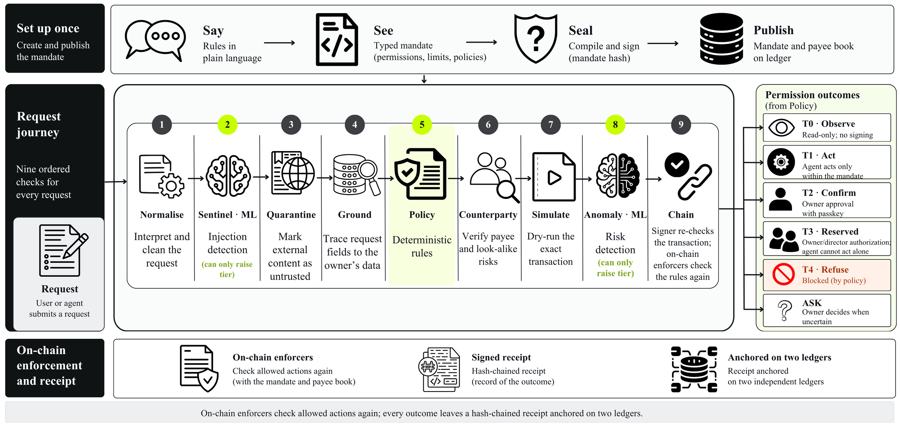

# YINGLONG Core Algorithms

*Technical documentation, part 2 of 3. Part 1 is [ARCHITECTURE.md](ARCHITECTURE.md). Part 3 is [SECURITY_DESIGN.md](SECURITY_DESIGN.md). The full reference is [TECHNICAL.md](TECHNICAL.md) and [ENFORCERS.md](ENFORCERS.md).*

This document describes the algorithms the system relies on: how rules become code, how a request becomes a tier, how the on-chain rules decide, how evidence is built, how the private mandate works, and the four small models with the methods, data and measured results behind them. Numbers come from the repository's generated evidence (`docs/evidence/bundle.json`, `ml/results/*.json`, `bench/reports/summary.json`) and are test results on synthetic or fictional data, not estimates for real users.

---

## 1. From plain words to enforceable rules: the mandate compiler

**Input.** A mandate document (schema `yinglong.mandate/v1`): integer amounts in base units, a payee list, per-period category budgets, tiers (an act-alone cap, a confirm cap, a hard ceiling), a reserve floor, a velocity limit, a jurisdiction profile and an expiry. The owner's plain sentences are kept as model input but are never enforced.

**Algorithm** (`packages/mandate/src/compile.ts`):

1. Validate the document with the schema. Refuse a document whose target allowlist overlaps the forbidden set or contains the owner's own account.
2. Canonicalise to JSON with sorted keys and compute `mandateHash = keccak256(canonical JSON)`.
3. Emit the caveat array in a fixed order: allowed targets, allowed methods, value cap 0, forbidden targets, global pause, agent lineage, mandate binding, jurisdiction, verified payee, one co-sign per asset tier, one category budget per asset, one reserve floor per floor, velocity, suitability. The allowlists always come first.
4. ABI-encode each caveat's `terms` (signed) and leave `args` empty (untrusted, unsigned).
5. The delegation hash is computed the way the framework computes it (`EncoderLib`), and the registry recomputes it from the published caveats, so the bytes that are published are provably the bytes that are enforced.

**Decompiler and round trip** (`packages/mandate/src/roundtrip.ts`, and independently `tools/verify-py`): decode every caveat back into a rule and an English sentence, and check four things: the published caveats equal the compiled ones byte for byte; the recomputed delegation hash equals the recorded one; the mandate hash in the binding equals the hash of the document; every caveat decodes to a known rule. The two implementations share only data (deployment tables, ABIs, golden vectors) and must agree: 2 golden files and 67 cross-implementation vector cases, 0 disagreements.

**Hash Ring** (`docs/HASH_RING.md`). The 32-byte delegation hash is drawn as 64 ticks (one nibble each) and nine arcs from `keccak256(H)`. Editing one amount in a mandate changes at least 16 ticks, so a changed rule is visible at a glance. It proves identity of the hash, not that the mandate is wise.

## 2. From a request to a tier: the decision algorithm



A request passes nine ordered checks (`apps/agent/src/pipeline.ts`), each marked passed, stopped, escalated or skipped. The tier it ends with is computed by this procedure:

```
tier   = evaluatePolicy(request)              # deterministic mirror of the enforcers: T1, T2, T3 or T4
tier   = T4 if counterparty is sanctioned or look-alike
flags  = signals from checks 1, 2, 3, 4 (document-derived amount) and 8   # the models and rules that can only escalate
if flags and tier in (T1, T2):  tier = ESCALATE[tier]    # T1 -> T2, T2 -> ASK
if the request was ambiguous and tier is not T3/T4: tier = ASK
```

`ESCALATE = {T1: T2, T2: ASK}`; T3 and T4 never change. **Monotonic rule:** no model signal can lower a tier or produce a refusal. This is tested exhaustively (72 cases) and with 5,000 random escalation chains.

**Policy mirror** (`scales/policy.ts`). The mirror decodes the same caveat bytes and reads the same on-chain counters as the enforcers (spent this period, usage in this window, paused, live, payee lookup, trusted-agent lookup, product risk class, rail kind, balances), and returns a tier with a typed refusal, the block it read and a hash of every state read. Because it is a mirror and not the authority, the next check runs the real redemption as a simulation and the tier must agree with it. A disagreement for a T1 becomes ASK.

**Tier meanings.** T0 observe (read-only); T1 act inside every rule; T2 above the act-alone cap, or any T1 a signal flagged: the owner signs with a passkey; T3 reserved for the owner (change a rule, add a payee, above the ceiling); T4 a rule refuses. ASK: the system is not sure and the owner decides.

## 3. Defended execution: the algorithms of the first checks

| Check | Method |
|---|---|
| **Normalise** | Unicode NFKC; strip zero-width and bidirectional control characters; flag tokens that mix scripts (look-alike letters); scrub private keys, 18-digit mainland ID numbers, card numbers, mobile numbers and seed phrases before any text goes to a model |
| **Sentinel** (M1) | A fine-tuned multilingual encoder scores the text; a score at or above the validation-chosen threshold (0.2) raises the tier. Fallback: a labelled regex sentinel |
| **Quarantine** | Untrusted documents sit behind opaque handles. Two readers (a deterministic regex reader and, when available, an LLM reader) return a closed schema; an amount is used only if both agree. "Payee details changed", instructions aimed at the agent and urgency are flags. A prompt guard throws if any 24-character window of quarantined text appears in the planner's prompt |
| **Understand** | The planner sees only the owner's words. Its output is a strict JSON schema; the payee is an *enum of identifiers from the owner's payee book plus `NEW_PAYEE_REQUEST`*, so it cannot emit an address. Amounts are integer arithmetic on base units, never floats |
| **Ground** | Amount digits must appear in the owner's words (or be agreed by the readers, then flagged); the asset must be in the mandate; the payee must resolve to the book |
| **Counterparty** | Payee book entry, passport and issuer attestations, a look-alike test (same first and last four hex characters as a known payee), a small local sanctions list |
| **Simulate** | `eth_call` of the real redemption at the latest block; T1 must succeed, T2 must revert `CoSignRequired`, T3 and T4 must revert |
| **Anomaly** | A rule over the receipt log (an amount above three times the largest past payment to the same payee; the first sweep into a product), then the behaviour model M3 (section 7.2); both can only escalate |
| **Chain** | The DelegationManager runs every caveat again; a refusal reverts with a typed error |

The understanding step uses, in order: Qwen 3.8 27B on Cerebras (strict JSON schema; each proposal records its latency in `understanding.latencyMs`), then Alibaba Cloud Model Studio (configured, but its account is not activated, so it is skipped), OpenRouter free models, a local llama.cpp model (the fine-tuned adapters, when served), and finally a deterministic rule parser. A model error produces a wrong *proposal*, which the owner sees and the checks above still test; it cannot produce a wrong *payment*.

## 4. On-chain algorithms (the caveat enforcers)

Every money enforcer reads the payment from the execution calldata with one decoder (`PaymentDecoder`): an ERC-20 `transfer`, an ERC-1363 `transferAndCall` (beneficiary is the first word of the data) or an `instruct` on the coin-free rail. Native value and any other shape revert. The *beneficiary*, never an agent argument, decides the payee check, the budget category and the act-alone threshold.

| Enforcer | Algorithm |
|---|---|
| **Category budget** | Period index `p = (now - start) / length`. Counter key = hash(manager, account, asset, category, p). Revert `CategoryBudgetExceeded` if `spent + amount > cap`. A category with no cap has cap 0; unknown payees fall into an "unlisted" category. Keyed by *account*, not by delegation, so re-sealing a mandate can never reset what was spent |
| **Reserve floor** | In the after-all hook: the account's balance after the whole redemption must be at least the floor, else `ReserveFloorBreached`. On the coin-free rail the balance is the posted balance minus pending instructions |
| **Velocity** | Fixed windows `w = now / window`. Counter = {count, outflow}. Revert if the count or the outflow exceeds the limit. Defeats splitting a large payment into many small ones |
| **Co-sign (T2)** | Threshold = new-payee cap, or the category cap, or the default cap. Above the ceiling always reverts (T3). Above the threshold an approval must be attached: the owner's own ERC-1271 signature over an EIP-712 `Approval(delegationHash, executionHash, nonce, expiry)`, with the nonce used once and the expiry inside the sealed window. A plain ECDSA signature can never satisfy a passkey-only account |
| **Verified payee** | The beneficiary must be in the account's payee book (or a sealed attested agent wallet); intermediaries are sealed in the terms, so a payment cannot be routed through an unlisted escrow |
| **Agent lineage** | The redeemer must hold an active passport whose owner identity hash equals the one sealed in the terms |
| **Mandate binding** | The mandate must be live in the public registry and its delegation must equal the one being redeemed |
| **Jurisdiction** | The paid asset must be in the sealed list; under the mainland profile the rail kind must be the coin-free rail, whatever the list says |
| **Global pause** | Refuse every redemption while the account (or the agent identity) is paused |
| **Suitability** | When money flows into a listed product, its risk class must not exceed the sealed class |

Each refusal is a *named* error, so a reverted attack is attributed to the rule that stopped it. Ten invariants are tested (unit tests, a stateful fuzz campaign and bounded symbolic proofs for five of them); see [SECURITY_DESIGN.md](SECURITY_DESIGN.md) section 8.

## 5. Evidence algorithms: receipts, Merkle roots, cross-anchors

**Receipt** (`packages/sdk/src/receipt.ts`). Each action, allowed or refused, produces a record with hashes of the intent, plan, policy decision, state reads, counterparty check, simulation, approval, transaction, explanation and AI-use block, plus the hash of the *previous* receipt. The receipt hash is an EIP-712 hash under the ledger's own domain, so receipts form a chain: removing or editing one breaks every later hash.

**Batching and anchoring** (`apps/indexer/src/anchoring.ts`). Receipts are pulled every 15 seconds and batched (up to 16, or 5 minutes). A sorted-pair Merkle tree (the OpenZeppelin convention) gives a root; `anchorBatch(root, count, uri)` is called on each configured ledger; then each ledger records the other's latest root, block number and block hash (`crossAnchor`). Anyone can ask for a receipt's Merkle path and the contract verifies it (`verifyReceipt`).

A receipt proves that the owner sealed a mandate, that an agent executed an action through it, that the enforcers allowed it or refused it with a named error, and that the decision record existed at that time. It does not prove that the owner wanted this specific action, that the model reasoned correctly or that the off-chain parts were uncompromised.

## 6. The private mandate: a zero-knowledge algorithm

A public caveat array shows a person's limits and payees. The private mandate puts only a commitment on-chain and proves compliance per payment (`contracts/src/zk`, `circuits`).

**Statement.** The prover knows `(cap, allowlistRoot, expiry, salt)` that open the public `mandateCommitment` (Poseidon2); a depth-8 Merkle path that puts the payee in the allowlist; and `(oldTotal, oldBlind)` that open the previous running commitment; and the claimed time is at most the expiry; `oldTotal + amount <= cap` (no overflow); and the new running commitment equals Poseidon2(`oldTotal + amount`, `newBlind`).

**Binding.** The ten public inputs include the delegation hash and the chain id, so a proof cannot be moved to another delegation or chain. The enforcer takes the commitment from the signed terms, the payee and amount from the real transfer calldata, and the old running commitment from its own storage; only a nonce, the claimed time, the new commitment and the proof come from untrusted arguments.

**Anti-replay and anti-overspend.** The claimed time must be within five minutes before and one minute after the block time; each nonce is used once; the stored running commitment advances only after a valid proof, so two proofs that each pass cannot both land if together they exceed the hidden cap.

Measured: circuit of 4,554 gates, proof size 7,616 bytes, verifier gas about 2.3 million; 59 Foundry tests pass with real proofs; deployed and exercised on Anvil, Base Sepolia and FISCO. Limits: amounts and payees are visible in the transfer calldata, so only the cap, the expiry and the rest of the allowlist stay hidden; the circuit is unaudited.

## 7. The models

All four models are *advisory*. They can only raise a tier, they run on synthetic data, and they are measured with confidence intervals. Where each runs today: M1, M3 and M5 are live in the model service; M4's adapters are trained and published but the live agent uses Qwen 3.8 27B on Cerebras first (Section 3).

### 7.1 M1: the injection sentinel

*Task.* Given one untrusted text of at most 320 tokens (an invoice memo, an email, a payee note, OCR text, a chat message), return the probability that it contains an instruction aimed at the agent, a jailbreak or a manipulation.

*Method.* Fine-tune an encoder for classification. Three arms on the same data: mmBERT-base (primary), mmBERT-small (low latency), mDeBERTa-v3-base (control). Training on Kaggle GPUs: 3 epochs, 6% warm-up, weight decay 0.01, best epoch by validation macro-F1; finance rows duplicated once; 19,371 training rows; four language settings (English, Bengali, Chinese, code-mixed). The decision threshold is chosen on the validation split so the test split is used once. Served as ONNX with int8 weight-only quantisation, checked against the full-precision model (99.8% agreement on 500 rows), mean latency about 380 ms on the host CPU.

*Results.* On 2,099 test items: macro-F1 96.72% (95% interval 95.99 to 97.45), recall 96.2%, specificity 97.4%, at threshold 0.2. An English-only public detector scores 0.745 on the same items. On an external set of 1,812 items: macro-F1 95.6%. On the benchmark's own held-out attack family: it misses 3 of 36 (8.3%). It raises a tier on about one in seven benign documents in the benchmark's legitimate set (specificity 85.5%), which is the price of catching more attacks and is paid in extra confirmations, not in lost money.

### 7.2 M3: behaviour anomaly (escalates only)

*Task.* Given the features of one action, return a conformal p-value and a flag to escalate.

*Features (23).* The amount against this payee's history (log amount, robust z-score, ratio to the median, ratio to the owner's threshold), time (hour, weekday, night), recency and counts (time since the last payment to this payee, payments to this payee in 24 hours, payments in the last hour and day, an equal amount in 24 hours), near-threshold splitting (amount just below the threshold, count in 24 hours), newness (new payee, history length, address age), a look-alike score, and whether the instruction came from untrusted content or a schedule. The agent computes them from its receipt log in `apps/agent/src/scales/anomaly-model.ts`, mirroring `ml/anomaly/world.py`.

*Method.* Two scorers are combined: an isolation forest (unsupervised: unusual combinations) and a gradient-boosted tree model (LightGBM, supervised on nine injected anomaly families). A Mondrian conformal calibration, separately for each archetype (student or business), turns the combined score into a p-value with a controlled false-escalation rate. The calibrated threshold is alpha = 0.022. Data: 177,209 simulated actions by 90 wallets over one year (11,043 anomalous), split by wallet into training, calibration and test. One family (a known payee whose address silently changes) is held out from the supervised model.

*Results.* On 38,907 normal test actions the false-escalation rate is 2.1%, against a 2% target. AUROC 0.994, area under the precision-recall curve 0.986. Escalation recall is 98 to 100% for split payments, look-alike addresses, bursts, inflated invoices, x402 drains, large payments to a new payee and dormant-wallet reactivation. Weak spots: a duplicate payment (recall 45%, almost indistinguishable from a real repeat) and the held-out address swap (87%).

*In the agent.* The rule check runs first; then the 23 features go to the model service. A flag raises the tier by one and shows the reason ("behaviour model: unusual action"). If the service is down or slow (3 s timeout), the rule result stands and the proposal says so.

### 7.3 M4: the intent and mandate model

*Task.* From the owner's message (and today's date, the default unit and the payee book) produce an intent in the strict schema; from a paragraph of rules, produce a mandate draft. Decoding is grammar-constrained and validated; the model never receives or produces an address.

*Method.* LoRA adapters on three open models: Qwen3-1.7B, Qwen3.5-2B, Qwen3-4B (non-thinking). Rank 16, alpha 16, two epochs, learning rate 2e-4, effective batch 16, 1,332 steps. Synthetic data: 17,400 generated rows, 12,398 kept after validation (71.3%). Exported to GGUF for a local llama.cpp server.

*Results.* Valid JSON on 99.9% of test items; exact match 85.7% for the smallest and 88.7 to 88.8% for the other two. An untuned Gemma model (E2B, 300-item sample) prompted zero-shot reaches 10.3% valid JSON and 0.7% exact match on the same task.

### 7.4 M5: cash-flow forecast

*Task.* For a company: balance quantiles for each of the next 28 days and the probability that the balance falls below the reserve floor within 14 days.

*Method.* Three forecasters compared on eight fictional small businesses with three years of daily balances: a zero-shot time-series foundation model (Chronos-2) given the known future covariates (payroll, supplier and utility payments), a LightGBM quantile model with eleven quantiles from 5% to 95%, and a seasonal-naive baseline. Breach probability is calibrated with isotonic regression. Scaled pinball loss: LightGBM 0.077, Chronos-2 0.093, seasonal 0.145. LightGBM trains in 20 seconds and is served as small text files; Chronos-2 needed 396 seconds of CPU for the test origins.

*In the agent.* The treasury forecast has two parts. A deterministic projection of scheduled flows with a computed breach date (the part that is authoritative). Beside it, the M5 percentile bands (5th, 50th, 95th) over 28 days, from the balance history rebuilt from confirmed payments plus the known payroll and supplier run-rate as future covariates. The bands never replace the deterministic breach date; the reserve floor itself is enforced by a contract.

## 8. The benchmark algorithm

YINGLONG-Bench has 300 attacks in 13 families (direct injection; hidden instructions in an invoice memo, an email, a payee note, a token name or an x402 description; look-alike addresses; urgency and false authority; split payments; manipulation inside the owner's limits; planted memory entries; hidden text in images; Bengali and code-mixed attacks), run along three paths: through the agent (ask), with the owner's approval, and *raw* (straight to the chain, skipping the agent). The judge is a **post-condition on the chain**: after each attempt, did any value leave the account to an address outside the sealed rules? Run on a local chain with the real contracts.

Result of the run on 18 Oct 2026: **0 of 300 moved value outside the mandate** (upper 95% bound 1.0%); all 208 raw attempts were blocked by the chain; the stock-caveat control (framework enforcers only, no YINGLONG enforcers) lost value in 90 of 105 hijacks. Where an attack stays inside the owner's own limits (a within-mandate manipulation), 9 of 44 items were pushed through and the loss is capped by the limits; this rate is reported, not hidden.

## 9. Limits of these algorithms

Test data are synthetic and written by one model family; Bengali and code-mixed rows have not been reviewed by a native speaker; there is no human-written test set yet. The models are advisory and can be wrong, which is why none of them can lower a tier. The behaviour model was added after the final benchmark run: because it can only escalate and fails open, it cannot cause value to move, but the benchmark numbers do not include its effect on the number of requests sent to "ask". The zero-knowledge circuit and the enforcers have no third-party audit.
