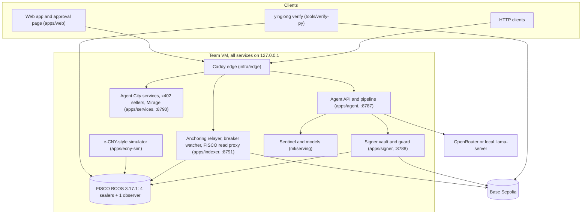
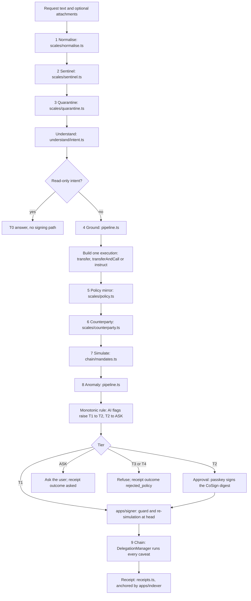
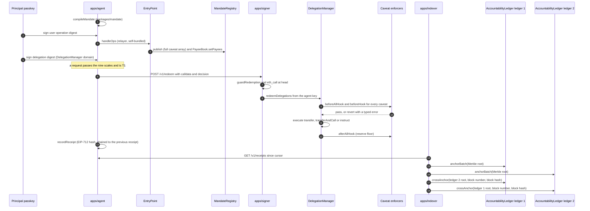

# YINGLONG Technical Documentation

*Personal Agent Identity & Mandated Finance. 2026 Shenzhen International FinTech Competition, International Track, Topic F (Agent Wallet).*

**Summary (10 lines)**
1. YINGLONG lets an AI agent move money for a person or a company only inside a mandate that the principal sealed; the mandate is an ERC-7710 delegation whose caveat enforcers are the rules, so the chain, not the model, has the final word.
2. The mandate is identity-bound: the delegate must hold an active agent passport whose owner DID equals the principal's, and the delegation is valid only while its mandate is live in a public `MandateRegistry` that stores the full caveat array.
3. One mandate, two ledgers: the same compiled caveats are built to run unchanged on a public EVM testnet (Base Sepolia) and on a team-run FISCO BCOS 3.17.1 consortium chain; the recorded runs in the repository are on FISCO and the local Anvil bench, where 37 of the 41 contracts of the deployment script have identical runtime code hashes and the 4 that differ are framework contracts with deployment-time immutables.
4. A request passes nine ordered checks ("scales") in `apps/agent/src/pipeline.ts`; only deterministic code refuses, AI signals can only escalate (T1 to T2, T2 to ask), and the enforcers decide again at redemption.
5. Persons hold passkey smart accounts (HybridDeleGator with owner = address(0)); companies hold 2-of-3 director accounts (MultiSigDeleGator); every principal action is a self-bundled user operation sent straight to the EntryPoint.
6. Two independent implementations (TypeScript `packages/mandate`, Python `tools/verify-py`) recompile a mandate, recompute the delegation hash, decode every caveat into an English sentence and compare byte for byte with what the ledger holds.
7. A Noir zero-knowledge enforcer keeps a mandate's cap, payee list and expiry private while still enforcing them at redemption; it is deployed on Anvil and FISCO with a 59-of-59 Foundry result recorded in `circuits/MANIFEST.json`.
8. Every action, allowed or refused, yields an EIP-712 accountability receipt that is hash-chained, batched into a Merkle root and anchored on each configured ledger with cross-anchors between them.
9. Jurisdiction is a rule in code: Hong Kong and international profiles use test units; the mainland profile accepts only coin-free payment instructions executed by an e-CNY-style simulator.
10. Everything that moves is a test unit or a coin-free instruction; the FISCO chain is run by the team; passkeys in automated runs are scripted software keys; there is no audit and no bank partnership.

---

## 0. Reading this document

| Label | Meaning |
|---|---|
| **Test units** | `tHKD`, `tUSD` (`contracts/src/rails/TestUnits.sol`) and coin-free CNY instructions have no monetary value |
| **Simulator** | `apps/ecny-sim` is an e-CNY-style conditional-payment simulator: not the PBoC sandbox, no connection to PBoC or operator-bank systems |
| **Team-run** | The FISCO BCOS chain (four consensus nodes and one observer node standing in for a regulator) runs on one team VM; anchoring proves consistency, not independent consensus |
| **Scripted passkey** | Automated runs sign with a software P-256 key and say so: "scripted passkey (software P-256 key)" (`packages/sdk/src/account.ts`, `softwarePasskey`) |
| **No audit, no partnership** | No third-party audit has been performed; no bank, licence, e-CNY integration or production readiness is claimed |
| **Generated numbers** | A value shown as `not yet measured` sits in a generated-number marker and is filled from code output; every other figure cites the repository file it comes from |

Fictional parties: Nadia Rahman (a student in Hong Kong), Lotus Lane Trading (Shenzhen), Harbour Homes, Harbour Bay University (HBU), Harbour Digital Bank, Pearl River FX Desk, Shenzhen Components and the rogue agent Mirage.

---

## 1. The problem and the primitive

### 1.1 The problem

An AI agent that can pay is useful only if four questions have checkable answers: who is this agent and for whom does it act; what exactly may it do, and who decided that; can a manipulated model or a stolen agent key make it do anything else; and can anyone verify afterwards what it did and why. Prompts cannot answer the third question, and a server-side policy engine answers it only for whoever trusts the server. China's 2026 agent guidance, the *Implementation Opinions on the Standardized Application and Innovative Development of Intelligent Agents* (CAC with NDRC and MIIT, 8 May 2026; our translation), separates decisions only the user makes, decisions needing the user's authorisation and autonomous agent decisions, and asks that agents never exceed the authorised scope. YINGLONG turns those classes into tiers that the ledger enforces.

### 1.2 The primitive: an identity-bound mandate

A **mandate** is a digital power of attorney enforced by code. Its life cycle, with the code that implements each step:

| Verb | What happens | Code |
|---|---|---|
| Say | The principal states rules in plain language; the mandate document keeps those sentences (`sentences`, model input only, never enforced) | `packages/mandate/src/scenarios.ts` |
| See | The rules are a typed document, schema `yinglong.mandate/v1` (zod), with integer amounts in base units | `packages/mandate/src/schema.ts` |
| Compile | `compileMandate` turns the document into the exact caveat array of an ERC-7710 root delegation; the mandate hash is `keccak256` of canonical JSON | `packages/mandate/src/compile.ts`, `canonical.ts` |
| Seal | The principal's account publishes the mandate with its full caveat array in `MandateRegistry` and writes its `PayeeBook` in one user operation, then signs the delegation under the DelegationManager's EIP-712 domain | `apps/agent/src/chain/mandates.ts` (`sealMandate`) |
| Enforce | At every redemption the DelegationManager runs each caveat enforcer | `contracts/src/enforcers/*.sol` |
| Verify | Anyone recompiles the document, recomputes the delegation hash and decodes the published bytes into sentences | `packages/mandate/src/roundtrip.ts`, `tools/verify-py` |
| Prove | Every action produces a receipt anchored on the ledgers | `apps/agent/src/receipts.ts`, `apps/indexer` |
| Pause, revoke | One passkey signature pauses every delegation of the account; revoking the mandate in the registry stops its delegation | `KillSwitchRegistry.tripWithSig`, `MandateRegistry.revoke` |

Two bindings make the mandate **identity-bound**:

1. **Agent identity.** `AgentLineageEnforcer` accepts a redeemer only if `YinglongPassportRegistry.walletInfo(redeemer)` returns an active passport whose `ownerDidHash` equals `keccak256(principal.did)` sealed in the terms. The passport is controlled by a dedicated `agent-owner` key, apart from the user's account, so no delegation can rotate the agent wallet (`apps/agent/src/chain/passport.ts`).
2. **Public mandate record.** `MandateBindingEnforcer` accepts a redemption only if `MandateRegistry.delegationOf(mandateHash)` equals the delegation being redeemed and the mandate is live. The registry recomputes the delegation hash from the published caveats itself (`computeDelegationHash`, using the framework's `EncoderLib`), so the published bytes are provably the enforced bytes.

### 1.3 One mandate, two ledgers

The same compiler output runs unchanged on every ledger profile in `packages/sdk/src/ledgers.ts`: `anvil` (local bench), `base-sepolia` (public testnet, chain id 84532) and `fisco` (team-run FISCO BCOS 3.17.1, chain id 20200). All YINGLONG contracts avoid immutables so their runtime bytecode does not depend on the ledger (section 4.4); EIP-712 domains carry an explicit per-ledger salt, `keccak256("YINGLONG-" + ledger name)` (`contracts/script/DeployYinglong.s.sol`). Recorded end-to-end runs exist for Anvil and FISCO (`apps/agent/data/e2e-anvil.json`, `apps/agent/data/e2e-fisco.json`); Base Sepolia deployment status: <!-- gen:deploy.base.status -->deployed (46 contracts)<!-- /gen -->.

### 1.4 Permission tiers

| Tier | Meaning | How the code reaches it | Enforced where |
|---|---|---|---|
| **T0** Observe | Read balances and activity | Intent kinds `query_balance`, `query_activity`, `query_forecast` (`answerQuery` in `pipeline.ts`); no signing path | Off-chain, read only |
| **T1** Act | Inside every rule; the agent acts alone | Policy mirror returns T1, simulation succeeds, no AI flag | Every caveat at redemption |
| **T2** Confirm | Above the T1 threshold and at most the T2 ceiling, or any T1 action an AI signal flagged | `CoSignEnforcer` threshold in the policy mirror; `ESCALATE` T1 to T2 in `pipeline.ts` | `CoSignEnforcer` verifies the account's own ERC-1271 signature |
| **T3** Reserved | Change the mandate, add a payee, above the T2 ceiling, company decisions outside the lanes | Intents `add_payee`, `change_mandate`, payee `NEW_PAYEE_REQUEST`; policy `AboveTierCeiling`; company board proposals (`apps/agent/src/board.ts`) | Only the account itself (passkey or 2-of-3 directors) through a user operation; `AllowedTargetsEnforcer` and `ForbiddenTargetsEnforcer` keep these contracts out of any delegation's reach |
| **T4** Refuse | A rule refuses | Any deterministic policy refusal other than `AboveTierCeiling`; counterparty verdict `sanctioned` or `look-alike` | Off-chain refusal; the same redemption reverts on-chain with a typed error |
| **ASK** ("T?" in the plan) | Not sure; the user decides | Ambiguities, ungrounded fields, ledger disagreeing with the mirror, AI escalation from T2 | Off-chain; nothing is signed by the agent. When the ask comes only from AI escalation of an otherwise valid, grounded payment, an approval request is attached and the user's explicit passkey approval executes it through the T2 path |

---

## 2. Architecture

### 2.1 Five pillars

| Pillar | Question it answers | Code |
|---|---|---|
| **Pearl**, trusted identity | Who is this agent and for whom does it act? | `contracts/src/registries/YinglongPassportRegistry.sol`; `AgentLineageEnforcer`; A2A agent cards bound to the passport (`apps/services/src/cards.ts`) |
| **Seal**, controlled authority | What may it do and who decides? | `packages/mandate`; `MandateRegistry`, `PayeeBook`, `KillSwitchRegistry`; the custom enforcers |
| **Scales**, defended execution | Can it be tricked or go rogue? | `apps/agent/src/pipeline.ts` and `apps/agent/src/scales/*`; `apps/signer` |
| **Vein**, traceable evidence | Can anyone check what it did and why? | `apps/agent/src/receipts.ts`; `AccountabilityLedger`; `apps/indexer`; `tools/verify-py` |
| **Gate**, compliant settlement | Is it lawful where the principal lives? | `JurisdictionEnforcer`; `contracts/src/rails/*`; `apps/ecny-sim` |

### 2.2 Components



| Component | Role | Entry point |
|---|---|---|
| `apps/agent` | HTTP API, the nine scales, approvals, board proposals, receipts, Judge's Challenge | `src/server.ts`, `src/pipeline.ts` |
| `apps/signer` | The only process that signs redemptions with agent keys; listens on 127.0.0.1 only | `src/server.ts`, `src/guard.ts` |
| `apps/indexer` | Anchoring relayer (Merkle batches, two-way anchors), breaker watcher (trip only), read-only FISCO JSON-RPC proxy | `src/anchoring.ts`, `src/breaker.ts`, `src/rpc-proxy.ts` |
| `apps/services` | Fictional service agents: FX desk quotes and KYB checks sold over x402 (`exact` scheme, ERC-7710 permission contexts, seller-settled), signed A2A agent cards, Mirage fixtures | `src/app.ts`, `src/x402/*`, `src/cards.ts`, `src/mirage.ts` |
| `apps/ecny-sim` | Plays the operator bank for the coin-free rail: executes or rejects `ConditionalPaymentInstructions` | `src/simulator.ts` |
| `packages/mandate` | Schema, canonical JSON, compiler, decompiler, round-trip check, Hash Ring, scenario mandates | `src/*.ts` |
| `packages/sdk` | Ledger profiles, deployments, ABIs, accounts and user operations, receipts, Merkle, revert decoding, key loading | `src/*.ts` |
| `packages/provenance` | `Tagged<T>`, opaque handles, the prompt guard | `src/index.ts` |
| `ml/serving` | M1 injection sentinel (ONNX int8) and other advisory models | `app.py` |
| `contracts` | Foundry project: registries, enforcers, rails, ZK router and enforcer, deploy script, tests | `src`, `test`, `script` |
| `contracts-fisco` | FISCO probe, framework spike, code-hash comparison | `script/*.mjs`, `reports/*.json` |
| `circuits` | Noir circuit, prover, verifier export, manifest | `mandate_compliance`, `prover`, `MANIFEST.json` |

### 2.3 One action, step by step

`ask(principalId, text, attachments)` in `apps/agent/src/pipeline.ts` runs every request through the scales in order. Each scale reports `passed`, `stopped`, `escalated` or `skipped` in the proposal's `scales` array, which is what the API returns and what the Judge's Challenge shows.



| # | Scale | Module | What it does | Can it refuse? |
|---|---|---|---|---|
| 1 | Normalise | `scales/normalise.ts` `normalise()` | NFKC; strips zero-width and bidi control characters; flags mixed-script tokens (homoglyphs); scrubs private keys, 18-digit mainland IDs, UnionPay and other card numbers, mainland mobile numbers and seed phrases before any text leaves the machine | No, escalates |
| 2 | Sentinel | `scales/sentinel.ts` `sentinel()` | Calls the M1 injection classifier at `SENTINEL_URL/sentinel` (ONNX int8, `ml/serving/app.py`) with a 4 s timeout; otherwise a labelled regex fallback `heuristicSentinel` ("heuristic sentinel (fallback, rules)"); score at least 0.5 means injection | No, escalates |
| 3 | Quarantine | `scales/quarantine.ts` `readDocument()` | Untrusted attachments (invoice, email, quote) go into an opaque `HandleStore`; a deterministic regex reader and, if available, an LLM reader return a closed schema (payee as a PayeeBook id or `NEW_PAYEE_REQUEST`, amount, currency enum, flags); an amount is used only if both readers agree; disagreement, "payee details changed", instructions aimed at the agent or urgency pressure become flags | No, escalates |
| - | Understand | `understand/intent.ts` `understand()` | Converts only the user's own words into the `Intent` schema (section 7.3); the planner prompt never contains attachment text, and `HandleStore.assertClean` flags a request that repeats quarantined text | No |
| 4 | Ground | inline in `ask()` | Amount digits must appear in the user's words or come from an agreed reader field (then flagged); the asset must be one of the mandate's; the payee must resolve to a PayeeBook entry; ambiguities become a question | No, asks |
| 5 | Policy | `scales/policy.ts` `evaluatePolicy()` | A deterministic TypeScript mirror of the enforcers, decoding the same caveat bytes and reading the same on-chain counters (`spentNow`, `usage`, `isPaused`, `isLive`, `lookup`, `isTrustedAgentWallet`, `productInfo`, `railKindOf`, balances); returns T1, T2, T3 or T4 with typed refusals, `blockNumber`, `blockTimestamp`, `stateReads` and `stateReadsHash` | **Yes** (T4, T3) |
| 6 | Counterparty | `scales/counterparty.ts` `checkCounterparty()` | PayeeBook entry, passport and trusted-issuer attestation, a look-alike check against the payee book (same first and last four hex characters) and a small local demo sanctions list; verdicts `verified-payee`, `attested-agent`, `unverified`, `look-alike`, `sanctioned` | **Yes** (`sanctioned`, `look-alike` give T4) |
| 7 | Simulate | `chain/mandates.ts` `simulateRedemption()` | `eth_call` of `DelegationManager.redeemDelegations` from the agent address at the latest block; the result must agree with the tier (T1 succeeds, T2 reverts `CoSignRequired`, T3/T4 revert); a T1 disagreement becomes ASK | No, asks |
| 8 | Anomaly | inline in `ask()` | Rules over the receipt log: an amount above three times the largest past confirmed payment to the same payee (with at least two past payments) is flagged, and so is the first sweep into a product ("you decide once, later sweeps can run alone") | No, escalates |
| 9 | Chain | `DelegationManager` and the enforcers | At redemption every caveat runs again; a refusal reverts with a typed error, recovered by `replayRevert` (`eth_call` at the parent block) | **Yes** (final) |

After the tier is fixed, the proposal is stored (`apps/agent/data/proposals.json`) and:

- **T1**: `execute()` sends the redemption calldata to `apps/signer` (`POST /v1/redeem`); the signer runs `guardRedemption` (only `redeemDelegations` on the deployment's DelegationManager, single-call default mode, leaf delegate equal to this agent, an execution on a YINGLONG asset with a payment selector, no native value), accepts only decisions T1 or T2-with-approval, re-simulates at the current head and only then signs and submits. On a policy refusal it asks the breaker watcher to pause the account.
- **T2**: `createCosignApproval()` reads `CoSignEnforcer.approvalDigest(delegationHash, keccak256(execution), nonce, expiry)` and stores an approval request with the typed data and the decoded payment. When the passkey signature arrives, `submitApproval()` first checks `isValidSignature` on the account (ERC-1271 magic `0x1626ba7e`), attaches `abi.encode(nonce, expiry, signature)` as args of the CoSign caveats and executes.
- **T3 and T4**: nothing is signed; a receipt with outcome `rejected_policy` is written. For a company principal, a T4 refusal by a breaker-class rule (`BREAKER_RULES`, default `VelocityExceeded`) trips the kill switch through the breaker watcher (`tripBreaker`).
- **Bypass** (Judge's Challenge and attack drills only): `bypass()` and `hijack()` push a T4 redemption to the chain through the signer's `chain-test` mode, which accepts only T4 decisions, so the ledger's own typed revert becomes evidence.

### 2.4 Monotonic-safety rule

Deterministic code decides; AI only proposes, explains or escalates. In `pipeline.ts`:

```ts
const ESCALATE: Record<Tier, Tier> = { T0: "T0", T1: "T2", T2: "ASK", T3: "T3", T4: "T4", ASK: "ASK" };
// ...
if (aiFlags.length && (tier === "T1" || tier === "T2")) tier = ESCALATE[tier];
if (asked && tier !== "T4" && tier !== "T3") tier = "ASK";
```

`aiFlags` collects signals from scales 1, 2, 3, 4 (amount taken from a document) and 8. They can raise T1 to T2 and T2 to ASK; they never lower a tier and never produce T3 or T4. T4 comes only from `evaluatePolicy` refusals and the deterministic counterparty rules. The signer independently refuses anything that is not T1 or approved T2, and the enforcers never read model output. Property test status: <!-- gen:tests.monotonic.status -->passing: 2 property tests, exhaustive 72 cases and 5,000 random escalation chains (apps/agent/test/tiers.test.ts)<!-- /gen -->.

---

## 3. On-chain design

All contracts: Solidity 0.8.23, `evm_version = london`, optimizer 200 runs, `bytecode_hash = "none"`, `cbor_metadata = false` (`contracts/foundry.toml`), built against the MetaMask Delegation Framework v1.3.0 git submodule (`contracts/lib/delegation-framework`). The ZK verifier is compiled separately with solc 0.8.27 for london (section 6).

### 3.1 Contracts and what each enforces

| Contract | Path | Enforces or records |
|---|---|---|
| `MandateRegistry` | `src/registries/MandateRegistry.sol` | Account-only `publish`, `supersede`, `revoke`; at most one live mandate per (account, lineage); recomputes the delegation hash from the published caveats; stores `caveatsHash = keccak256(abi.encode(caveats))`, version, jurisdiction (1 to 3), validity; `isLive` = status Live and inside the validity window; ERC-8226-compatible reads `canExecute(account, agent, ...)` and `isFrozen` |
| `PayeeBook` | `src/registries/PayeeBook.sol` | Per-account verified payees with a budget category and a label hash; only the account writes its own book |
| `KillSwitchRegistry` | `src/registries/KillSwitchRegistry.sol` | `trip` (account or its guardians), `tripWithSig` (relayed passkey signature over `Trip(account, nonce, deadline)`), `tripIfStale` (dead-man timer), `setAgentHalt` (supervisor, pause only); unpause only by the account (`untrip`, `untripWithSig`); `isPaused(account, agent)` |
| `YinglongPassportRegistry` | `src/registries/YinglongPassportRegistry.sol` | Agent passport: controller, agent wallet (bound by the wallet's own `BindWallet` signature), owner DID hash, VC, provenance, enforcer-table and JWKS hashes, `kid`, placeholder identity code ("YL-TEST-..."), ERC-8004 id field; issuer attestations with expiry; supervisor halt and resume; reverse lookup `walletInfo` |
| `AccountabilityLedger` | `src/registries/AccountabilityLedger.sol` | Append-only Merkle roots of receipt batches (`anchorBatch`), cross-anchors of the other ledger's root and block (`crossAnchor`), optional per-receipt log, `verifyReceipt` with OpenZeppelin `MerkleProof` |
| 13 custom caveat enforcers | `src/enforcers/*.sol` | See section 3.2 and `docs/ENFORCERS.md` |
| `ZKVerifierRouter`, `ZKMandateEnforcer` | `src/zk/*.sol` | ERC-8262-style verifier router (append-only proof types) and the private-mandate enforcer (section 6) |
| `TestUnits` (tHKD, tUSD) | `src/rails/TestUnits.sol` | Test units with 6 decimals, a rail kind and a label; ERC-1363 `transferAndCall`; EIP-3009 `transferWithAuthorization` for EOA signers only (smart-account signatures are refused, so a phished passkey signature cannot move these units outside the caveats) |
| `ProtectedPayment` | `src/rails/ProtectedPayment.sol` | Escrow funded by `transferAndCall`; released only by the named release attester, refunded after the refund time |
| `SignedQuoteSettlement` | `src/rails/SignedQuoteSettlement.sol` | Converts at a desk-signed price; quote bound to its payer, single use, `QuoteExpired` after expiry |
| `ProductRegistry`, `TestMoneyMarketFund` | `src/rails/*.sol` | Test products with risk classes 1 to 5; a class-2 fund and a class-5 twin for the suitability demo |
| `ConditionalPaymentInstructions` | `src/rails/ConditionalPaymentInstructions.sol` | Coin-free mainland rail: accounts issue instructions; the operator (simulator) executes or rejects; `balanceOf` = posted balance minus pending instructions; `railKind = 3` |
| `YinglongCreate2Deployer` | `src/utils/YinglongCreate2Deployer.sol` | Minimal CREATE2 factory for identical addresses where wanted |
| `PaymentDecoder` | `src/libraries/PaymentDecoder.sol` | The only way money enforcers read a payment (section 3.3) |
| `YinglongEIP712` | `src/utils/YinglongEIP712.sol` | EIP-712 domain with an explicit salt in storage and `block.chainid` read at call time (no immutables) |

Framework contracts deployed by `DeployYinglong` in `deploy` mode (Anvil, FISCO): EntryPoint v0.7, DelegationManager (owner = supervisor), HybridDeleGator and MultiSigDeleGator implementations, SimpleFactory, plus our own copies of nine stock enforcers. In `existing` mode (Base Sepolia, `scripts/deploy.mjs`) the canonical MetaMask v1.3.0 framework addresses are reused and only the stock enforcers and YINGLONG contracts are deployed.

### 3.2 Caveat order emitted by the compiler

`compileMandate` (`packages/mandate/src/compile.ts`) emits, in this order: `AllowedTargetsEnforcer` (the mandate's assets), `AllowedMethodsEnforcer` (`transfer`, `transferAndCall`, `instruct` as sealed), `ValueLteEnforcer` (0), `ForbiddenTargetsEnforcer`, `GlobalPauseEnforcer`, `AgentLineageEnforcer`, `MandateBindingEnforcer`, `JurisdictionEnforcer`, `VerifiedPayeeEnforcer`, one `CoSignEnforcer` per asset tier, one `CategoryBudgetEnforcer` per asset budget, one `ReserveFloorEnforcer` per floor, `VelocityEnforcer`, `SuitabilityEnforcer`. The allowlists always come first, and the compiler refuses a mandate whose target allowlist overlaps the forbidden set or contains the principal's own account. A mandate with a reputation gate makes the compiler throw at this commit (no ERC-8004 reputation registry address is configured). `VetoTimelockEnforcer`, `ZKMandateEnforcer` and the stock `LimitedCalls`, `Timestamp`, `Nonce`, `Redeemer`, `ERC20TransferAmount`, `AllowedCalldata` are deployed but not emitted by the mandate compiler (x402 children carry `ERC20TransferAmount`, `LimitedCalls(1)` and `Timestamp`, checked by `apps/services/src/x402/erc7710.ts`). The TypeScript decompiler decodes a `ZKMandateEnforcer` caveat (rule kind `zkMandate`) when the deployment lists the ZK stack; it has no sentence for the other non-emitted enforcers, so a delegation carrying one fails the round-trip check "every rule decodes".

Worked examples in the repository: `packages/mandate/golden/nadia.json` (16 caveats) and `packages/mandate/golden/lotus.json` (13 caveats), each with its caveat bytes, delegation hash, decoded rules and sentences.

### 3.3 Term layouts

Terms are signed (the delegation hash covers `keccak256(terms)`); args are not and are untrusted. Full detail per enforcer, including state keys and tests, is in `docs/ENFORCERS.md`.

| Enforcer | Terms | Bytes | Args |
|---|---|---|---|
| `AllowedTargetsEnforcer` (stock) | packed `address[]` | `20n` | none |
| `AllowedMethodsEnforcer` (stock) | packed `bytes4[]` | `4n` | none |
| `ValueLteEnforcer` (stock) | `uint256 max` | 32 | none |
| `ForbiddenTargetsEnforcer` | packed `address[]` | `20n` | ignored |
| `GlobalPauseEnforcer` | `(address killSwitch, address passportRegistry)` | 64 | ignored |
| `AgentLineageEnforcer` | `(address passportRegistry, bytes32 ownerDidHash, address pinnedFacilitator)` | 96 | ignored |
| `MandateBindingEnforcer` | `(address mandateRegistry, bytes32 mandateHash)` | 64 | empty or `(bytes32 intentHash, uint256 receiptNonce)`, logged only |
| `JurisdictionEnforcer` | `(uint8 profile, address[] allowedAssets)` | `96 + 32n` | ignored |
| `VerifiedPayeeEnforcer` | `(address payeeBook, address passportRegistry, address[] trustedIssuers, address[] intermediaries)` | `192 + 32(i + k)` | ignored |
| `CoSignEnforcer` | `(address payeeBook, address asset, uint256 defaultT1Cap, uint256 newPayeeT1Cap, uint256 t2Ceiling, uint256 maxApprovalWindow, uint32[] categoryIds, uint256[] categoryT1Caps)` | `320 + 64n` | empty or `(uint256 nonce, uint256 expiry, bytes signature)`, verified by ERC-1271 |
| `CategoryBudgetEnforcer` | `(address payeeBook, address asset, uint64 periodStart, uint64 periodLength, uint32 unlistedCategory, uint32[] categoryIds, uint256[] caps)` | `288 + 64n` | ignored |
| `ReserveFloorEnforcer` | `(address asset, uint256 floor)` | 64 | ignored |
| `VelocityEnforcer` | `(address asset, uint64 window, uint32 maxCount, uint256 maxOutflow)` | 128 | ignored |
| `SuitabilityEnforcer` | `(address productRegistry, uint8 maxRiskClass)` | 64 | ignored |
| `ReputationGateEnforcer` | `(address reputationRegistry, address passportRegistry, address[] clients, int128 minScore, uint8 minScoreDecimals, string tag1)` | `256 + 32c + 32*ceil(len/32)` | ignored |
| `VetoTimelockEnforcer` | `(uint256 window)` | 32 | ignored (`schedule` is a separate call) |
| `ZKMandateEnforcer` | `(address router, bytes32 mandateCommitment)` | 64 | `(uint256 nonce, uint64 claimedTime, bytes32 newRunningCommitment, bytes proof)`, given meaning only by the proof |

Every money enforcer decodes the payment from the execution calldata with `PaymentDecoder`: ERC-20 `transfer` (beneficiary = recipient), ERC-1363 `transferAndCall` (recipient = the rail contract, beneficiary = the first word of `data`), or `instruct` on the coin-free rail. Native value and any other shape revert (`NativeValueNotAllowed`, `UndecodableExecution`). The beneficiary, never an agent argument, determines the payee check, the budget category and the T1 threshold.

### 3.4 Typed errors

Every refusal reverts with a typed error from `contracts/src/utils/Errors.sol` or `contracts/src/zk/ZKErrors.sol`, so a revert can be attributed to the rule that produced it; `decodeRevert` (`packages/sdk/src/errors.ts`) and `yinglong verify-tx` decode them.

| Rule | Error | Rule | Error |
|---|---|---|---|
| Payee | `PayeeNotVerified(payee)` | Lineage | `LineageViolation(redeemer)` |
| Budget | `CategoryBudgetExceeded(categoryId, spent, cap)` | Binding | `MandateNotLive(mandateHash)`, `MandateDelegationMismatch(mandateHash, expected, actual)` |
| Reserve | `ReserveFloorBreached(asset, balanceAfter, floor)` | Forbidden | `ForbiddenTarget(target)` |
| Velocity | `VelocityExceeded(count, outflow)` | Reputation | `ReputationTooLow(agentId, score, minScore)` |
| Suitability | `UnsuitableProduct(product, riskClass, maxRiskClass)` | ZK | `InvalidMandateProof()`, `ClaimedTimeOutOfRange`, `AmountOutOfRange` |
| Jurisdiction | `RailNotPermitted(asset, profile)` | Veto | `VetoWindowOpen(readyAt)`, `Vetoed()`, `NotScheduled()` |
| Pause | `Paused(account, agent)` | Quote rail | `QuoteExpired(expiry, now)` |
| Tier | `CoSignRequired(amount, threshold)`, `AboveTierCeiling(amount, ceiling)` | Decoding and input | `UndecodableExecution`, `NativeValueNotAllowed`, `InvalidTerms`, `InvalidArgs`, `InvalidExecutionMode` |
| Signatures | `InvalidSignature`, `SignatureExpired`, `NonceAlreadyUsed` | Roles | `Unauthorized(caller)` |

Stock enforcers revert with framework strings (for example `AllowedMethodsEnforcer:method-not-allowed`).

### 3.5 Invariants

The ten invariants of the design, and the evidence in the repository at this commit. Fuzzing and bounded symbolic campaign results are generated (<!-- gen:invariants.passing -->5/10 (invariants 1, 2, 3, 4, 5 held in one Foundry stateful-fuzz campaign of 128 runs x 64 calls; 5 of the 10 have no fuzz campaign; source: forge test in this finalize run)<!-- /gen -->; symbolic: <!-- gen:proofs.symbolic.status -->6 of 6 properties proved within bounds for invariants 1, 2, 3, 4, 5 (halmos 0.3.3, loops unrolled to 4, solver timeout 300 s; enforcer hooks executed symbolically, the DelegationManager and the account are not; Kontrol not run)<!-- /gen -->).

| # | Invariant | Mechanism | Unit evidence (`contracts/test`) |
|---|---|---|---|
| 1 | No redemption sequence exceeds any category or period cap | `CategoryBudgetEnforcer` counters keyed by account, asset, category, period | `test_T4_categoryBudgetExceeded_food`, `test_resealNeverResetsBudgets` |
| 2 | The reserve floor is never breached | `ReserveFloorEnforcer.afterAllHook` | `test_T4_reserveFloorBreached` |
| 3 | A paused or revoked mandate moves nothing | `GlobalPauseEnforcer` (beforeAllHook), `MandateBindingEnforcer` (`isLive`) | `test_pause_passkeySignatureRelayedByAnyone`, `test_supervisorHaltsAgentIdentity`, `test_revokedMandateMovesNothing` |
| 4 | Only verified payees receive funds | `VerifiedPayeeEnforcer`, intermediaries sealed | `test_T4_payeeNotVerified_mirage`, `test_escrow_cannotRouteToUnverifiedPayeeThroughEscrow` |
| 5 | No redemption can change signers, the PayeeBook, the kill switch, the agent wallet or the EntryPoint deposit | Target allowlist of assets only; `ForbiddenTargetsEnforcer` (delegator, DelegationManager, registries, EntryPoint); passport controlled by a separate key | `test_T4_selfCallToAccountIsForbidden`, `test_T4_tokenApprovalIsNotAnAllowedMethod` |
| 6 | A sub-agent chain decrements the root's counters exactly once | Counters keyed by the root delegator | Not yet tested (no sub-agent chains are compiled) |
| 7 | At most one live delegation per lineage; re-sealing never widens a counter | `LineageHasLiveMandate` in `MandateRegistry`; counters not keyed by delegation | `test_resealNeverResetsBudgets` |
| 8 | A ZK proof cannot be redeemed twice; two proofs above the hidden cap fail on the second | Nonce set and running commitment in `ZKMandateEnforcer` | `test_invariant8_twoValidProofsAboveCap_secondFails`, `test_invariant8_reverseOrder_secondFails`, `test_redeem_invariant8_secondFails` |
| 9 | A 65-byte ECDSA signature never satisfies `CoSignEnforcer` on a passkey-only account | Account has owner = address(0); ERC-1271 check | `test_T2_ecdsaSignatureNeverSatisfiesPasskeyAccount` |
| 10 | The facilitator cannot redeem an x402 child twice or above the price | `LimitedCalls(1)` and `ERC20TransferAmount` on the child | vitest `apps/services/test/x402.test.ts` ("rejects a second attempt that reuses the same permission context") |

### 3.6 Accounts and keys

**Persons: passkey accounts.** A person's account is an ERC1967 proxy of `HybridDeleGator` created through the framework `SimpleFactory` with CREATE2, initialized with **owner = address(0)** and P-256 keys only (`hybridInitData(keyIds, xs, ys, owner = 0)` in `packages/sdk/src/account.ts`). There is no seed phrase and no ECDSA owner, which is why an ECDSA signature can never pass the account's ERC-1271 check (invariant 9). The account accepts the framework's raw P-256 format (`keccak256(keyId) || r || s` over `sha256(hash)`, low-s) and WebAuthn assertions. Where the RIP-7212 precompile is absent, as on FISCO, the framework's `P256SCLVerifierLib` falls back to a Solidity verifier (section 4.3). In automated runs the key is a deterministic software key (`seededPasskey`), labelled "scripted passkey (software P-256 key)"; how the recorded seals were signed: <!-- gen:passkey.mode -->3 seals by a WebAuthn passkey and 6 by a scripted passkey (software P-256 key) in the live receipts; scripted passkey (software P-256 key) in the scripted e2e runs<!-- /gen -->. The onboarding code registers one passkey per account.

**Companies: 2-of-3 directors.** A company's account is a `MultiSigDeleGator` proxy whose signers are three director EOAs (ECDSA keys) with threshold 2 (`multisigInitData`); `multisigSign` sorts the signatures by signer address as the framework requires. Board proposals (`apps/agent/src/board.ts`) build one user operation for an action outside the agent's lanes (for example an equipment purchase or resuming a paused treasurer) and execute it when two directors have signed. In the demo, director signatures are produced by the service with testnet director keys.

**Self-bundled user operations.** Principals act on-chain only through user operations (EntryPoint v0.7 `PackedUserOperation`) signed over `getPackedUserOperationTypedDataHash` and submitted by our relayer directly to `EntryPoint.handleOps` (`submitUserOp`, `actAsPrincipal`); no third-party bundler is involved. Success is read from the `UserOperationEvent` success flag, not only from the transaction status. On FISCO gas price is 0, so user operations pay nothing.

**Signer guard (agent key).** `apps/signer/src/guard.ts` accepts exactly one transaction kind for an agent key: `DelegationManager.redeemDelegations` with 1 to 8 entries, single-call default mode, a non-empty delegation chain whose leaf delegate is this agent, an execution target that is a YINGLONG asset (`TestHKD`, `TestUSD`, `ConditionalPaymentInstructions`, or `SIGNER_EXTRA_ASSETS`), a payment selector and no native value. The server then requires decision T1 (or T2 with approval) and a successful `eth_call` at the current head before signing.

**Signing-domain guard (user passkey).** The approval page's guard (`apps/web/lib/signing-guard.ts`) is the only path that hands a challenge to the user's passkey. It accepts exactly the primary types `Delegation` (DelegationManager), `Approval` (CoSignEnforcer), `Receipt` (AccountabilityLedger), `Trip` and `Untrip` (KillSwitchRegistry), `Veto` (VetoTimelockEnforcer) and `PackedUserOperation` (EntryPoint), each only for its request kind, and only if the digest it is asked to sign equals the EIP-712 hash it recomputes from the typed data it displays; EIP-3009 transfers, ERC-2612 Permit, Permit2, raw `personal_sign` and unknown domains are refused. Message kinds in the allowlist: <!-- gen:guard.allowlist.count -->7<!-- /gen -->.

| Role (key file role name) | Can | Cannot | Where |
|---|---|---|---|
| User passkey | Seal, approve T2, pause and resume, every T3 action through a user operation | n/a | HybridDeleGator |
| Directors `director-1..3` | 2-of-3 company actions, seal the company mandate | Act alone | MultiSigDeleGator |
| Agent wallet `agent-ying`, `agent-treasurer`, `guest-arena` | Redeem its delegations inside the caveats | Anything else (guard and caveats) | `apps/signer` |
| Passport controller `agent-owner` | Register, rotate the agent wallet (`setAgentWallet`, new wallet signs), update hashes, revoke | Spend | `YinglongPassportRegistry` |
| Relayer `relayer` | Submit user operations and relayed pause signatures; operator of `ConditionalPaymentInstructions` | Sign for a principal | `packages/sdk/src/account.ts`, `apps/ecny-sim` |
| Guardian `guardian`, breaker watcher `breaker-watcher` | `trip` the accounts that named them | Unpause, spend | `KillSwitchRegistry`, `apps/indexer/src/breaker.ts` |
| Supervisor `supervisor` | Halt or resume an agent identity (`setAgentHalt`, `supervisorSetStatus`); owner of the DelegationManager on Anvil and FISCO; admin of `AccountabilityLedger` | Spend, rotate keys, change mandates | `DeployYinglong.s.sol` |
| Anchoring relayer `anchoring-relayer` | Append roots and cross-anchors | Alter or delete a root | `AccountabilityLedger` |
| Issuers `issuer-hbu`, `issuer-harbour-digital-bank` | Attest passports | Anything else | `YinglongPassportRegistry.attest` |
| Deployer `deployer` | Deploy; remains minter of the test units and admin of `ProductRegistry` | n/a | `DeployYinglong.s.sol` |

Keys are testnet keys loaded at runtime from a file outside the repository (`packages/sdk/src/server.ts`, `YINGLONG_SECRETS`); deployer roles after setup: <!-- gen:deploy.deployer_roles -->4 roles still held by the deployer key `0x5C470480380dC2014898345aC6226c67cbF5E407` on FISCO BCOS: ProductRegistry.admin(), TestHKD.minter(), TestUSD.minter(), ZKVerifierRouter.registrar() (scan of 46 contracts, 461 getter calls, block 534); Base Sepolia not deployed<!-- /gen -->.

### 3.7 Pause, revoke, re-seal, rotate

| Action | Mechanism | Evidence |
|---|---|---|
| Pause | Passkey signs `Trip(account, nonce, deadline)` (`KillSwitchRegistry.tripDigest`); the relayer calls `tripWithSig` as a plain transaction; `GlobalPauseEnforcer` refuses every redemption with `Paused` | `apps/agent/data/e2e-fisco.json`: pause transaction confirmed in 487 ms at block 189 of the team-run chain (one run); `pipeline.ts` `createPauseApproval` and `POST /v1/principals/:id/pause`. Median on <!-- gen:time.ledger -->FISCO BCOS (team-run consortium ledger)<!-- /gen -->: <!-- gen:time.pause.p50 -->0.222<!-- /gen --> s server-side (n = <!-- gen:time.pause.n -->7<!-- /gen -->) |
| Resume | Only the account: `untrip` or `untripWithSig` | `resume (passkey)` step in the same file |
| Supervisor halt | `setAgentHalt(agent)` or passport status halted | `test_supervisorHaltsAgentIdentity` |
| Revoke | `MandateRegistry.revoke` from the account; `MandateBindingEnforcer` then refuses; `DelegationManager.disableDelegation` available in the same user operation | `test_revokedMandateMovesNothing`; time to revoke <!-- gen:time.revoke.p50 -->0.213<!-- /gen --> s (median, server-side, n = <!-- gen:time.revoke.n -->5<!-- /gen -->) |
| Re-seal | `sealMandate` revokes the live mandate of the lineage and publishes the new one in one user operation (or `supersede` plus `disableDelegation`); counters keyed by account carry over | `test_resealNeverResetsBudgets` |
| Rotate agent key | `setAgentWallet` by the controller, signed by the new wallet | `test_drill_leakedAgentKeyIsBoundedByCaveats` |

---

## 4. Ledgers

### 4.1 Ledger profiles (`packages/sdk/src/ledgers.ts`)

| Profile | Chain id | Time unit | Transactions | Badge shown next to every hash |
|---|---|---|---|---|
| `anvil` | 31337 | seconds | EIP-1559 | "Anvil bench (simulated)" |
| `base-sepolia` | 84532 | seconds | EIP-1559 | "Base Sepolia (testnet)" |
| `fisco` | 20200 (`FISCO_CHAIN_ID`) | seconds (`FISCO_TIME_UNIT`) | legacy, gas price 0 | "FISCO BCOS (team-run consortium ledger)" |

### 4.2 Base Sepolia

The public ledger. `scripts/deploy.mjs base-sepolia` runs `DeployYinglong` in `existing` mode against the canonical MetaMask Delegation Framework v1.3.0 (DelegationManager `0xdb9B1e94B5b69Df7e401DDbedE43491141047dB3`, EntryPoint v0.7 `0x0000000071727De22E5E9d8BAf0edAc6f37da032`, HybridDeleGator and MultiSigDeleGator implementations and SimpleFactory as listed in that script) and deploys our stock enforcer copies and every YINGLONG contract. The canonical DelegationManager's owner is a MetaMask key that can pause all redemptions there (known risk KR-17); the FISCO path is unaffected. The compiler adds Base-specific addresses to the forbidden set (EntryPoints v0.7 to v0.9, Circle Paymasters, ERC-8004 registries; `EXTRA_FORBIDDEN` in `compile.ts`). Status: <!-- gen:deploy.base.status -->deployed (46 contracts)<!-- /gen -->; seal transaction <!-- gen:tx.seal.base -->[`0xc356baed1d...`](https://sepolia.basescan.org/tx/0xc356baed1def52b262943d1e82a9f32dc9e204f7bdb6a9910ac03a9663531658) (scripted e2e run)<!-- /gen -->; reverted attack <!-- gen:tx.revert_payee.base -->not yet measured<!-- /gen -->.

### 4.3 FISCO BCOS 3.17.1 (team-run)

Facts below are from the generated results block of `infra/fisco/README.md`, produced from `infra/fisco/chain-facts.json`, `contracts-fisco/reports/probe-2026-10-16.json`, `contracts-fisco/deployments/fisco-spike.json` and `contracts-fisco/reports/codehash-compare-2026-10-16.json`.

| Item | Observed |
|---|---|
| Build | FISCO BCOS 3.17.1, standard (non-SM) build from the official release (SHA-256 pinned in `infra/fisco/build-chain.sh`); `sm_crypto` false, so KECCAK256 and CREATE2 behave as on Ethereum and EIP-712 hashes match |
| Layout | Chain `chain0`, group `group0`, PBFT, 4 consensus nodes (sealers) and 1 observer node standing in for a regulator, all on one VM; every FISCO socket bound to 127.0.0.1 |
| Chain id | `eth_chainId` 0x4ee8 = 20200; the CHAINID opcode inside a contract also returns 20200, so EIP-712 domains use 20200 (not 0) |
| Timestamps | `block.timestamp` in seconds (genesis feature `feature_evm_timestamp=1`) |
| Other features | `feature_evm_address=1`, `feature_evm_cancun=1`; `feature_balance` off, so native value transfers revert; gas price 0; `tx_gas_limit` 3,000,000,000 |
| P-256 | No RIP-7212 precompile at `0x100`; the framework's verifier falls back to the SCL Solidity verifier: a valid signature is accepted, a tampered one rejected, `eth_estimateGas` 261,807 gas. Passkey accounts therefore work |
| SM2 / SM3 | The crypto precompile at `0x...100a` answers: `sm3("abc")` matches the GB/T 32905 test vector; `sm2Verify` accepts a valid signature over e = SM3(Z_A \|\| M) with the default user ID and rejects a wrong message |
| Contract size | No EIP-170 runtime limit; the EIP-3860 initcode limit is enforced at the RPC |
| Simulation | No `eth_simulateV1` or `debug_trace*`; `eth_call` ignores state overrides and the block tag (always latest state); a reverted transaction is mined with status 0 and no revert data, which an immediate `eth_call` replay recovers |
| Logs | `eth_getLogs` needs `address`, `topics`, `fromBlock` and `toBlock`, lowercase topics; `blockHash` filters are rejected |
| EVM differences | `EXTCODEHASH` of an EOA is zero; gas metering differs from Ethereum, so FISCO gas figures are not comparable |
| Framework spike | Verdict GO: DelegationManager v1.3.0, HybridDeleGator, MultiSigDeleGator and stock enforcers deployed; a delegation signature validated through ERC-1271; a redemption within the cap succeeded, an over-cap redemption reverted `ERC20TransferAmountEnforcer:allowance-exceeded`, a redemption exactly to the cap succeeded |
| Governance | Auth check is off on this chain; the raw RPC is not public. The only public path is the read-only allowlisted proxy in `apps/indexer/src/rpc-proxy.ts` (`POST https://api.yinglong-agent.tech/rpc/fisco`), which the VM deployment points at the observer node |

How YINGLONG adapts: legacy transactions with gas price 0 (`txOpts`), revert reasons recovered by replay (`replayRevert`), the policy mirror and `eth_call` instead of `eth_simulateV1`, the simulator polls instructions by id rather than by logs, and the read proxy enforces the log-filter shape. Regulator node status: <!-- gen:fisco.regulator_node -->running: observer node4 (Web3 RPC 127.0.0.1:8549) serves the public read-only RPC at https://api.yinglong-agent.tech/rpc/fisco; run by the team<!-- /gen -->.

### 4.4 Identical bytecode

`DeployYinglong` records every address with its runtime `codeHash` (`EXTCODEHASH`) in `contracts/deployments/<ledger>.json`.

- **Anvil vs FISCO, full deployment** (`contracts/deployments/anvil.json`, `contracts/deployments/fisco.json`): 37 of the 41 contracts deployed by `DeployYinglong` have identical code hashes, including every registry, every custom enforcer, every stock enforcer copy and every rail. The 4 that differ are the framework contracts `DelegationManager`, `EntryPoint`, `HybridDeleGatorImpl` and `MultiSigDeleGatorImpl`, whose constructors write deployment-time immutables: OpenZeppelin `EIP712` caches the chain id and domain separator, `DeleGatorCore` stores the DelegationManager and EntryPoint addresses, and EntryPoint v0.7 stores the address of the `SenderCreator` it creates. The immutable-masking comparison in `contracts-fisco/reports/codehash-compare-2026-10-16.json` confirms, for the framework spike deployed at identical addresses, that these contracts are identical once the immutable slots are zeroed (and fully identical against an Anvil run with chain id 20200). Masked comparison for the full deployment: <!-- gen:bytecode.framework.masked_equal -->against Anvil chain id 31337: 16 of 16 identical once immutables are zeroed (13 identical as deployed; DelegationManager, HybridDeleGatorImpl, MultiSigDeleGatorImpl differ only in immutables); against Anvil chain id 20200: 16 of 16 identical once immutables are zeroed (16 identical as deployed) (framework spike, contracts-fisco/reports/codehash-compare-2026-10-16.json); the full DeployYinglong deployment has not been compared with immutables masked<!-- /gen -->.
- **ZK stack** (same files): `ZKVerifierRouter` and `ZKMandateEnforcer` have identical code hashes; `HonkVerifier` and its two linked libraries differ, because the verifier's runtime code embeds the library addresses (link offsets in `HonkVerifier.artifact.json`) and the libraries were deployed at different addresses.
- **Generated figure** (`apps/agent/scripts/finalize.ts` over every entry of the deployment files, Base Sepolia vs FISCO when both exist, else Anvil vs FISCO): <!-- gen:chain.bytecode.equal -->38<!-- /gen --> of <!-- gen:chain.bytecode.total -->46<!-- /gen --> contracts identical (<!-- gen:chain.bytecode.pair -->Base Sepolia vs FISCO BCOS<!-- /gen -->); different: <!-- gen:chain.bytecode.differ -->DelegationManager, EntryPoint, HybridDeleGatorImpl, MultiSigDeleGatorImpl, SimpleFactory, ZKRelationsLib, ZKTranscriptLib, HonkVerifier<!-- /gen -->.
- **YINGLONG enforcers only (<!-- gen:bytecode.pair -->Base Sepolia (public testnet) vs FISCO BCOS 3.17.1 (consortium ledger)<!-- /gen -->)**: <!-- gen:bytecode.equal -->13<!-- /gen --> of <!-- gen:bytecode.total -->13<!-- /gen --> equal; ledgers with every enforcer equal: <!-- gen:bytecode.ledgers -->2 (Base Sepolia (public testnet) and FISCO BCOS 3.17.1 (consortium ledger))<!-- /gen -->.

---

## 5. Round-trip verification

### 5.1 What is checked

`verifyRoundTrip` (`packages/mandate/src/roundtrip.ts`) runs four checks, and the API returns them with every mandate view (`GET /v1/principals/:id/state`):

1. the caveats published on-chain equal the caveats compiled from the mandate document, byte for byte;
2. the delegation hash recomputed from the published caveats equals the hash the registry recorded (the hash the DelegationManager enforces);
3. the mandate hash bound in `MandateBindingEnforcer` equals `keccak256` of the document's canonical JSON;
4. every caveat decodes into a known rule and an English sentence (no unknown enforcer).

`tools/verify-py` adds on-chain checks with only a JSON-RPC endpoint: the `MandatePublished` event's caveats, the registry's `caveatsHash`, `DelegationManager.getDelegationHash`, `disabledDelegations`, `isLive`, each enforcer's own `getTermsInfo` decoding of the terms, and the code hash of every enforcer, the DelegationManager and the registry against the deployment table. Its README states, per check, what it proves and what it does not.

### 5.2 Two implementations

| | TypeScript | Python |
|---|---|---|
| Location | `packages/mandate/src` | `tools/verify-py/src/yinglong_verify` |
| Shares with the other | nothing at runtime | only data: deployment tables, ABIs exported from `contracts/out`, golden vectors |
| Re-implements | canonical JSON, mandate hash, compiler, delegation hash (`EncoderLib` twin), decompiler, Hash Ring, receipt EIP-712 hash, `docHash`, sorted-pair Merkle | the same, independently |
| Agreement tests | golden writer `packages/mandate/scripts/golden.ts` | `tests/test_golden.py` (byte-for-byte caveats, delegation hash, rules, sentences, ring geometry), `tests/test_ts_vectors.py` (canonical JSON incl. UTF-16 key order, delegation hashes, mandate variants, compile errors, receipts, receipt chain, Merkle) |

Golden files on which both agree: <!-- gen:verify.golden.n -->2<!-- /gen -->; property cases: <!-- gen:verify.property.n -->67<!-- /gen -->; agreement: <!-- gen:verify.agreement -->agree: 2 golden files (packages/mandate vitest and 59 pytest cases) and 67 cross-implementation vector cases generated by the TypeScript reference and checked by the Python verifier (22 pytest cases) for the ledger profiles anvil, fisco; 0 disagreements; the base-sepolia profile is not in the shared vectors<!-- /gen -->.

### 5.3 The Hash Ring

`hashRingGeometry` (`packages/mandate/src/hashring.ts`, Python twin `hashring.py`) draws the 32-byte delegation hash H the DelegationManager accepts as 64 ticks (tick length from one nibble of H) and nine arcs from `keccak256(H)`; a revoked mandate drops four ticks at 12 o'clock. The vitest suite checks that random hash pairs differ in at least 16 ticks and that editing one amount in the mandate ("3,000" to "30,000") changes the delegation hash and at least 16 ticks. The ring proves hash identity, not mandate correctness.

### 5.4 Running it

```sh
# offline, against the bundled golden vector (no keys, no Node, no Foundry)
uvx --from 'git+https://github.com/ABRUBAB/YINGLONG#subdirectory=tools/verify-py' yinglong verify nadia --chain anvil --offline
# a published mandate by its hash, and a transaction with its typed revert
uvx --from 'git+https://github.com/ABRUBAB/YINGLONG#subdirectory=tools/verify-py' yinglong verify 0x<mandateHash> --chain fisco --rpc https://api.yinglong-agent.tech/rpc/fisco
uvx --from 'git+https://github.com/ABRUBAB/YINGLONG#subdirectory=tools/verify-py' yinglong verify-tx 0x<txHash> --chain fisco --rpc https://api.yinglong-agent.tech/rpc/fisco --expect PayeeNotVerified
```

---

## 6. The ZK private mandate

A public caveat array discloses a person's limits and payees. `ZKMandateEnforcer` (`contracts/src/zk/ZKMandateEnforcer.sol`) puts only a Poseidon2 commitment on-chain and enforces the hidden rules with an UltraHonk proof per payment.

**Statement** (`circuits/MANIFEST.json`): the prover knows (cap, allowlistRoot, expiry, salt) opening `mandateCommitment`, a depth-8 Poseidon2 path putting the payee in the allowlist, and (oldTotal, oldBlind) opening `oldRunningCommitment`, with claimedTime at most expiry, oldTotal + amount at most cap (u128, no overflow) and `newRunningCommitment` = Poseidon2(oldTotal + amount, newBlind).

**Public inputs** (circuit order): `mandate_commitment`, `delegation_hash_hi`, `delegation_hash_lo`, `chain_id`, `payee`, `amount`, `nonce`, `claimed_time`, `old_running_commitment`, `new_running_commitment`. The enforcer takes the commitment from the signed terms, the delegation hash from the hook, the chain id from `block.chainid`, payee and amount from the ERC-20 `transfer` calldata, the old running commitment from its own storage, and only nonce, T, the new commitment and the proof from the untrusted args. `test_eachPublicInputIsBound` flips each of the ten words and checks rejection.

**Rules the enforcer adds**: T must lie in `[block.timestamp - 300, block.timestamp + 60]`; each nonce once per (DelegationManager, delegationHash); the stored running commitment advances only after a valid proof, so two proofs that each pass cannot both land if together they exceed the cap (invariant 8). Verification goes through `ZKVerifierRouter.verifyProof(0x01, proof, publicInputs)`, an ERC-8262-style router whose proof types are append-only.

| Item (`circuits/MANIFEST.json`) | Value |
|---|---|
| Toolchain | nargo 1.0.0-rc.5, bb 5.2.1, noir_js 1.0.0-rc.5, bb.js 5.2.1; verifier solc 0.8.27 for london |
| Circuit | 135 ACIR opcodes, 4,554 gates, dyadic size 2^13 |
| Proof size | 7,616 bytes |
| Runtime sizes | HonkVerifier 18,530 B (EIP-170 limit 24,576 B); RelationsLib 8,074 B; ZKTranscriptLib 6,216 B; ZKMandateEnforcer 4,134 B; ZKVerifierRouter 1,949 B |
| Gas (Foundry) | `HonkVerifier.verify` 2,324,637; `router.verifyProof` 2,359,529; enforcer `beforeHook` 2,566,806 first / 2,543,348 later payment; `redeemDelegations` with the ZK caveat 2,832,510 / 2,815,420 |
| Foundry tests | 59 of 59 passed (`ZKMandateEnforcerTest`, `ZKMandateEnforcerDMTest`, `ZKVerifierRouterTest`) |
| vk hash | `0x05c62f51284e760d87811fdcc9218c1ebd0b101695ceb6cf002e43c391a48494` |

**On FISCO.** The stack is deployed on the team-run chain by `apps/agent/scripts/deploy-zk.ts` (two libraries, linked verifier, router, `registerVerifier(0x01)` transaction `0xb12640ada1452911b20bc9d2cd3fe11644e3ebfce0b5468b6b410a69aed7de97`, enforcer), with addresses, code hashes and deployment transactions in `contracts/deployments/fisco.json`. The verifier needs only the precompiles 0x05 to 0x08, which a standard (non-SM) FISCO build provides. The deployment commit reports that a real UltraHonk proof verifies against this verifier on FISCO; the verification call and its result are not yet stored in an evidence file, and `circuits/README.md` still lists execution on FISCO as pending. Mode: <!-- gen:zk.mode -->live private-mandate payments with real proofs recorded in zk-fisco.json, zk-base-sepolia.json, zk-anvil.json<!-- /gen -->; a ZK-enforced redemption on FISCO: <!-- gen:tx.zk.fisco -->[`0xab553f9cb9...`](https://app.yinglong-agent.tech/proof/tx/fisco/0xab553f9cb9ba3b3652d954104c5b784d93f2cbca77e39bce9d912a9e1bac6d0f) (gas 9,462,976, proof 1,993 ms)<!-- /gen -->; on Base Sepolia: <!-- gen:tx.zk.base -->[`0xea27417745...`](https://sepolia.basescan.org/tx/0xea27417745a05233ef384b6a5aff3e4705fc63dcbcc62bb2591510264b66089f) (gas 4,117,616, proof 2,183 ms)<!-- /gen -->.

**Limitations** (`circuits/README.md`): amounts and payees are visible in calldata, so only the cap, expiry, salt and the rest of the allowlist stay hidden; the token is not in the statement (pair with a one-token `AllowedTargets`); a proof may land up to 300 s after the hidden expiry; one transfer per redemption; payments under one delegation are sequential; at most 256 payees; the redeemer is not bound by the proof; the circuit and verifier are unaudited and Noir rc.5 is a release candidate; the trusted setup is Aztec's universal reference string.

---

## 7. The agent

### 7.1 Pattern

A privileged planner, quarantined readers and deterministic code, in the style of the dual-LLM (CaMeL) pattern without a code interpreter: the model that plans sees only the user's own words and closed enums; the models that read untrusted documents return only a closed schema; every amount, address and tier is computed by code. There is no `eval`, shell or interpreter on any path.

### 7.2 Provenance types (`packages/provenance/src/index.ts`)

- `Tagged<T> = { value, source, tainted, reader? }`; `tag()` marks every `untrusted:*` source (email, invoice, x402, agent card, chat) and `memory` as tainted.
- `HandleStore` keeps raw untrusted text behind opaque handles (`h_<random>`); only readers and the display layer resolve them. `assertClean(prompt)` throws if any quarantined text, or any 24-character window of it, appears in a prompt.
- `sha256Hex` pins prompts and schemas; the intent prompt's hash (`INTENT_PROMPT_SHA256`) is recorded in every proposal.

### 7.3 Intent schema: the payee is an enum

`intentSchema(payeeIds)` in `apps/agent/src/understand/intent.ts`:

| Field | Type |
|---|---|
| `kind` | `pay`, `convert`, `escrow`, `sweep`, `schedule`, `query_balance`, `query_activity`, `query_forecast`, `change_mandate`, `add_payee`, `pause`, `unknown` |
| `payee` | **enum of the principal's PayeeBook ids plus `NEW_PAYEE_REQUEST`**, or null: the model cannot emit an address at all, and a new payee always becomes a T3 request |
| `amount` | `{ value: decimal string (at most 6 decimals), unit: tHKD, tUSD, USDC or CNY }` or null |
| `category`, `when`, `conditions`, `ambiguities`, `language` | closed enums (`language`: en, bn, zh, mixed) |

The schema is sent as a strict JSON schema; output that fails zod validation is discarded. Amounts become base units with integer arithmetic (`toBaseUnits`), never floats.

### 7.4 Model provider chain with deterministic fallback (`apps/agent/src/llm/provider.ts`)

1. OpenRouter, models in order from `modelChain()` (overridable with `OPENROUTER_MODELS`), with `response_format: json_schema` (strict), `provider.require_parameters: true`, temperature 0 and a fixed seed; at most two attempts per model; a model answering 402 or 429 is skipped for 30 minutes or 1 minute.
2. A local llama-server (`LLAMA_URL`, for example the fine-tuned GGUF intent model) with the same JSON schema.
3. Otherwise `null`, and the caller falls back to deterministic code: `ruleParse` for intents, the regex reader for documents. `LLM_DISABLED=1` forces this path.

Every proposal records `understanding.via` (`llm` or `rules`), model, provider, latency and prompt hash, and every receipt commits to an `aigc` block naming the model. `GET /v1/health` reports which providers are configured, never the keys. Free API models may log prompts, which is why scale 1 scrubs personal data first.

### 7.5 Explanation validator (`apps/agent/src/explain.ts`)

Explanations are built from templates keyed by the decision (`execute`, `needs_approval`, `refused`, `ask`); code fills every amount, name, threshold and error name from the decision record. `validate()` extracts every numeral and hex string from the final text and requires each to appear in the record; on any miss the plain template without flags is used. At this commit no model writes explanation prose, so explanations carry `aiGenerated: false`; ungrounded-claim rate: <!-- gen:bench.ungrounded.rate -->not yet measured<!-- /gen -->.

### 7.6 Principals

`PRINCIPALS` in `apps/agent/src/world.ts` defines the demo principals: `nadia` (person, Hong Kong profile, agent "Ying", identity code placeholder "YL-TEST-0001"), `lotus-sz` (company, mainland profile, coin-free rail, 2-of-3 directors), `lotus-hk` (the same treasurer agent identity re-sealed under a Hong Kong mandate, being added at the time of writing) and `guest` (Judge's Challenge, tiny caps). `onboard()` is idempotent: it creates the account, the passport and its attestations, mints test units or posts an opening simulated balance, names the guardian and the breaker watcher, and seals the scenario mandate from `packages/mandate/src/scenarios.ts`. Each principal's ledger is chosen by an environment variable (`NADIA_LEDGER`, `LOTUS_SZ_LEDGER`, `LOTUS_HK_LEDGER`, `GUEST_LEDGER`).

---

## 8. Receipts and anchoring



**Receipt** (`packages/sdk/src/receipt.ts`, written by `recordReceipt` in `apps/agent/src/receipts.ts`): `receiptId, chainId, agentId, mandateHash, delegationHash, intentHash, planHash, policyDecisionHash, stateReadsHash, counterpartyCheckHash, simulationHash, tier, approvalSigHash, txHash, outcome, explanationHash, aigcHash, source, prevReceiptHash, timestamp`. Off-chain documents (intent, plan, policy decision, state reads, counterparty check, simulation, explanation, AIGC block with label "AI-generated", model and provider) are committed by hash. `source` is `live-base`, `live-fisco` or `anvil-bench`. The receipt hash is the EIP-712 hash under the domain `{name: "YINGLONG Accountability Ledger", version: "1", chainId, verifyingContract: AccountabilityLedger, salt: domainSalt}`, and each receipt names the previous receipt's hash, forming a chain. Records are appended to `apps/agent/data/receipts.jsonl`. Every refusal and every ask writes a receipt too.

**Anchoring** (`apps/indexer/src/anchoring.ts`): the relayer pulls receipts from the agent API every `INDEXER_POLL_MS` (default 15 s), batches up to `BATCH_MAX_RECEIPTS` (default 16) or `BATCH_MAX_AGE_MS` (default 5 minutes), builds a sorted-pair Merkle tree (`packages/sdk/src/merkle.ts`, the OpenZeppelin `MerkleProof` convention), calls `anchorBatch(root, count, uri)` on every ledger in `ANCHOR_LEDGERS`, then on each ledger `crossAnchor` with every other ledger's latest root, block number and block hash (with a single anchoring ledger, as in the VM default `ANCHOR_LEDGERS=fisco`, no cross-anchor is written). `GET /proof/:receiptId?verify=1` returns the receipt, its Merkle path, the root, the per-ledger anchor transactions and the result of `AccountabilityLedger.verifyReceipt` on-chain; `yinglong verify-receipt` checks the same offline. Anchor transactions: Base Sepolia <!-- gen:tx.anchor.base -->not yet measured<!-- /gen -->, FISCO <!-- gen:tx.anchor.fisco -->[`0xabfd11de2b...`](https://app.yinglong-agent.tech/proof/tx/fisco/0xabfd11de2b3e953db56a904d4625c2061787287958c4f80b9f49dae7024a0500) (19 receipts in one Merkle root)<!-- /gen -->.

| A receipt proves | It does not prove |
|---|---|
| The principal's key sealed mandate M (the delegation signature and the publish user operation) | That the principal wanted this specific action, only that it was inside M |
| Agent A executed X through delegation D bound to M | That the model's reasoning was correct |
| The enforcers allowed X, or reverted it with a typed error | That off-chain components were uncompromised; it commits to what they reported |
| The decision record existed when the receipt was written | That counterparties are honest beyond their attestations |
| The receipt is in a root anchored on the configured ledgers | The legal validity of any underlying contract |

---

## 9. Jurisdiction rails

| Profile (id) | Rail | Asset | Rail kind | Ledgers | Label |
|---|---|---|---|---|---|
| Hong Kong (1) | Regulated-digital-money **test** rail | `TestHKD` (tHKD), 6 decimals | 1 | every deployment | "Test units. Simulation of a regulated HKD instrument; not issued by any licensee." |
| International (2) | International **test** rail | `TestUSD` (tUSD), 6 decimals | 2 | every deployment | "Test units. International test rail; no monetary value." |
| Mainland (3) | **Coin-free** rail | `ConditionalPaymentInstructions` (CNY instruction units, 2 decimals) | 3 | FISCO in the scenarios | "e-CNY-style simulator. Not the PBoC sandbox; no connection to PBoC or operator-bank systems." |

**The rule in code.** `JurisdictionEnforcer` requires the paid asset to be in the sealed list and, under the mainland profile, requires `railKind() == 3` regardless of the list; `MandateRegistry` accepts only profiles 1 to 3. No mandate can therefore move value tokens under the mainland profile (`test_T4_railNotPermitted_mainlandProfileCannotMoveTokens`). This encodes the *Notice of the PBoC and Seven Other Departments on Further Preventing and Handling Risks Related to Virtual Currencies* (February 2026; our translation) as a rule rather than a policy statement.

**Coin-free mainland rail.** An account (through its agent's delegation) issues `instruct(payee, amount, purposeHash, conditionHash, validUntil)`; nothing of value moves on-chain. `apps/ecny-sim/src/simulator.ts`, holding the operator role, polls instructions by id, checks deterministic conditions (known payee, purpose, invoice or delivery condition, available balance, expiry) and calls `execute` or `reject` with a reason code (`PAYEE_NOT_KNOWN`, `CONDITION_NOT_MET`, `INSUFFICIENT_BALANCE`, `INSTRUCTION_EXPIRED`, `PURPOSE_NOT_ALLOWED`), keeping a statement per account. The posted balance minus pending instructions is `balanceOf`, so the reserve floor applies on this rail too.

**Service payments (x402).** `apps/services` sells FX quotes and KYB checks with the x402 v2 `exact` scheme and the `erc7710` asset-transfer method, seller-settled by default: the seller decodes the payer's permission context, requires a leaf with exactly one `ERC20TransferAmount(asset, price)`, `LimitedCalls(1)` and a short `Timestamp` window (`checkX402Child`), simulates the redemption, settles, waits for the receipt and only then delivers. Quotes are settled through `SignedQuoteSettlement`. Agent cards are A2A cards signed with JWS ES256 over RFC 8785 canonical JSON and bound to the passport by `kid` and `keccak256` of the JWKS, so Mirage's self-signed card fails verification. Settlement mode: <!-- gen:x402.mode -->seller-settled through ERC-7710 permission contexts with single-use exact-amount child delegations (no third-party facilitator); tested in apps/services/test<!-- /gen -->.

---

## 10. The API

`apps/agent/src/server.ts` (Hono, version string "0.9.0") serves JSON under `/v1`, reached publicly at `https://api.yinglong-agent.tech/v1/*`. Read routes are public; state-changing routes on the demo principals require the operator token in `x-admin-token`; the passkey-signed routes (approval signature, pause and resume requests) and the Judge's Challenge are public by design. Every route, with request and response shapes and curl examples, is in `docs/API.md`.

| Group | Routes |
|---|---|
| Health and identity | `GET /v1/health`, `GET /v1/principals`, `GET /v1/principals/:id/state`, `GET /v1/registry/agents` |
| Acting | `POST /v1/principals/:id/ask`, `GET /v1/proposals/:id`, `POST /v1/proposals/:id/execute`, `POST /v1/proposals/:id/bypass` |
| Approvals, pause | `GET /v1/approvals`, `GET /v1/approvals/:id`, `POST /v1/approvals/:id/signature`, `POST /v1/approvals/:id/decline`, `POST /v1/approvals/:id/demo-sign`, `POST /v1/principals/:id/pause`, `POST /v1/principals/:id/resume` |
| Mandates | `POST /v1/principals/:id/onboard`, `POST /v1/mandates/compile` |
| Evidence | `GET /v1/receipts`, `GET /v1/receipts/:id`, `GET /v1/evidence` |
| Company board | `GET /v1/board-proposals`, `POST /v1/principals/:id/board-proposals`, `POST /v1/board-proposals/:id/sign` |
| Judge's Challenge | `GET /v1/challenge/session`, `GET /v1/challenge/attempts`, `POST /v1/challenge/attempt` |
| Drills | `POST /v1/principals/:id/attack` |

---

## 11. Deployment

| Piece | Where | What |
|---|---|---|
| Edge | `infra/edge/Caddyfile`, `compose.yaml` | Caddy 2.11.7, the only process bound to 0.0.0.0 (80/443); automatic TLS. `yinglong-agent.tech` redirects to `app.`; `app.yinglong-agent.tech` proxies the web app on 127.0.0.1:3000 and serves a static page (`infra/edge/site/index.html`) while it is not running; `api.yinglong-agent.tech` routes `/v1/*` to the agent (8787), `/fx/*`, `/kyb/*`, `/mirage/*`, `/.well-known/*`, `/agents/*` to the services (8790), `/proof/*` and `/rpc/fisco` to the indexer (8791), and answers `/healthz` itself |
| Application | `infra/app/compose.yaml`, `Dockerfile` | One Node 24 image running TypeScript through tsx; host networking, every service on 127.0.0.1; services `signer`, `agent`, `services`, `ecny-sim` and `indexer`; testnet keys, the OpenRouter key file and the operator token mounted read-only from `/opt/yinglong/secrets`; state in `/opt/yinglong/data/<service>`. Defaults on the VM: both demo principals on FISCO (`NADIA_LEDGER`, `LOTUS_SZ_LEDGER`), anchoring on FISCO (`ANCHOR_LEDGERS`), the read-only RPC proxy pointed at the observer ("regulator") node on port 8549, and demo time compression `DEMO_PERIOD_SECONDS=86400` (one-day budget periods instead of 30 days, labelled in the interface) |
| FISCO | `infra/fisco/*` | `build-chain.sh` (pinned release, genesis features), `install-systemd.sh` (one unit per node), `add-observer.sh`, `collect-facts.sh`, `status.sh`, `backup.sh`; RPC on 127.0.0.1, reached through an SSH tunnel |
| Contracts | `scripts/deploy.mjs <anvil\|fisco\|base-sepolia>` | Runs `forge script DeployYinglong` with keys loaded from outside the repository (never printed); FISCO with `--legacy --with-gas-price 0`; writes `contracts/deployments/<ledger>.json`. ZK stack: `npx tsx apps/agent/scripts/deploy-zk.ts <ledger>` |
| Shipping | `scripts/vps-deploy.mjs` | `git bundle` of the committed repository to the VM, `docker compose up --build`, optional edge reload and secret upload |

Public endpoints: `https://app.yinglong-agent.tech` (web app) and `https://api.yinglong-agent.tech` (API). The domain is also the passkey relying-party id, so it must not change.

**Mainland reachability.** The VM is in a Hong Kong region, assets and fonts are self-hosted and no Google service is called at runtime. To check from the mainland, request `https://app.yinglong-agent.tech` and `https://api.yinglong-agent.tech/healthz` from probes on mainland networks (for example a Globalping HTTP measurement with mainland locations; ICMP is blocked by the cloud provider by default). Result: <!-- gen:reach.mainland -->not yet measured<!-- /gen -->.

---

## 12. Testing

| Suite | Command | What it covers | Passing |
|---|---|---|---|
| Foundry `NadiaMandateTest` | `cd contracts && forge test --match-contract NadiaMandateTest` | Every rule and tier of the student mandate through the real DelegationManager and a passkey HybridDeleGator: T1 payments, each T4 typed revert, T2 co-sign (replay, binding to the exact execution, ECDSA never valid), pause by relayed passkey signature, guardian, supervisor halt, revoke, re-seal keeps budgets, key-compromise drill, escrow, signed quote and `QuoteExpired` | <!-- gen:tests.forge.nadia -->30<!-- /gen --> |
| Foundry ZK suites | `cd contracts && forge test --match-path "test/zk/*"` | `ZKMandateEnforcerTest`, `ZKMandateEnforcerDMTest`, `ZKVerifierRouterTest` with real proofs | 59 of 59 at the last manifest run (`circuits/MANIFEST.json`) |
| All Foundry | `cd contracts && forge test` | | <!-- gen:tests.contracts -->390<!-- /gen --> |
| vitest `packages/mandate` | `pnpm --filter @yinglong/mandate test` | Canonical JSON, compiler order and determinism, one-word sensitivity, decompiler sentences, round trip, tamper detection, Hash Ring, parity with `getDelegationHash` when Anvil runs | <!-- gen:tests.vitest.mandate -->13<!-- /gen --> |
| vitest `apps/services` | `pnpm --filter @yinglong/services test` | x402 challenge, seller-settled payment, reuse refused, `QuoteExpired`, agent-card verification (Pearl River accepted, Mirage refused) | <!-- gen:tests.vitest.services -->5<!-- /gen --> |
| vitest `apps/indexer` | `pnpm --filter @yinglong/indexer test` | Batch anchoring with on-chain proof verification; read-only FISCO proxy (writes refused, log bounds, rate limit) | <!-- gen:tests.vitest.indexer -->7<!-- /gen --> |
| vitest `apps/ecny-sim` | `pnpm --filter @yinglong/ecny-sim test` | Conditional instructions executed or rejected with reason codes; statements | <!-- gen:tests.vitest.ecny_sim -->6<!-- /gen --> |
| `circuits/prover` (node test runner through tsx) | `pnpm --dir circuits test` | Poseidon2 golden values TypeScript = circuit, false statements refused, prove and verify, vk equality | <!-- gen:tests.node.prover -->12<!-- /gen --> |
| `apps/agent`, `apps/signer` | none yet | The pipeline, the monotonic-safety rule and the signer guard have no unit tests at this commit; they are exercised end to end by the scripts below | n/a |
| nargo | `cd circuits/mandate_compliance && nargo test` | Golden hashes, valid payment, cap exceeded, payee not listed, expired, u128 overflow | <!-- gen:tests.nargo.circuit -->not run: nargo is not installed on the evidence host<!-- /gen --> |
| pytest `tools/verify-py` | `cd tools/verify-py && uv run pytest` | Golden and TypeScript-vector agreement, unit tests, CLI, ledger integration | <!-- gen:tests.pytest.verify_py -->108 (7 skipped)<!-- /gen --> |

Totals: vitest <!-- gen:tests.ts -->176<!-- /gen -->, pytest <!-- gen:tests.py -->108<!-- /gen -->, all suites <!-- gen:tests.total -->795<!-- /gen -->. Coverage of `contracts/src`: <!-- gen:coverage.contracts -->lines 100% (856/856), statements 100% (1048/1048), branches 99.49% (197/198), functions 100% (183/183) of contracts/src (forge 1.8.5 coverage)<!-- /gen -->. Slither high findings open: <!-- gen:static.slither.high -->0 (raw high 0; Slither 0.11.6, 102 detectors over contracts/src)<!-- /gen -->.

**End-to-end scripts.**

| Script | What it does | Output |
|---|---|---|
| `apps/agent/scripts/e2e.ts <ledger>` | Student scenario with real transactions: passkey account, passport and attestation, test units, seal, T1 rent, T4 simulation and raw attack, T2 without approval (simulation), T2 escrow co-signed by passkey, relayed pause, agent blocked while paused, resume | `apps/agent/data/e2e-<ledger>.json` |
| `contracts-fisco/script/probe.mjs` | FISCO EVM and RPC probe | `contracts-fisco/reports/probe-<date>.json` |
| `contracts-fisco/script/spike.mjs` | Framework spike: deploy, sign a delegation, redeem within and over the cap | `contracts-fisco/deployments/fisco-spike.json` |
| `contracts-fisco/script/compare-codehash.mjs` | Code-hash comparison FISCO vs Anvil, with immutables masked | `contracts-fisco/reports/codehash-compare-<date>.json` |
| `apps/agent/scripts/demo-beats.ts` | Plays the scenario beats against a running agent API (including bypass attempts) and records every result | `apps/agent/data/beats-live.json` |
| `apps/agent/scripts/finalize.ts` | Evidence generator: reads the deployment files, the live receipts API, the scripted runs and (with `--tests`) every test suite, writes `docs/EXECUTION_EVIDENCE.md`, `PROOF.md` and `docs/evidence/bundle.json`, and fills every generated-number marker | the files listed |

**Recorded evidence.** The scripted student run on the team-run FISCO chain (`apps/agent/data/e2e-fisco.json`; scripted passkey, test units) records, in order: passport registration and attestation, test-unit mint, the seal user operation, a T1 rent payment, a simulated and then an on-chain raw redemption to Mirage reverted with `PayeeNotVerified`, a T2 escrow refused without approval (`CoSignRequired`, simulation) and then executed with the passkey co-signature, a relayed pause, the agent refused with `Paused`, and a resume; the same steps on the local bench are in `apps/agent/data/e2e-anvil.json`. The generated one-page table (also in `PROOF.md`):

<!-- gen:proof.table -->
| What it proves | Ledger | Transaction |
|---|---|---|
| Mandate sealed and published with its full caveat array (base-sepolia) | base-sepolia | `0xc356baed1def52b262943d1e82a9f32dc9e204f7bdb6a9910ac03a9663531658` |
| Mandate sealed and published with its full caveat array (fisco) | fisco | `0xc0e294dd54638c004a05d34e17f4df802f22af4e0e1e5ecc34c0dfbf0d2d4bc9` |
| Allowed payment inside the mandate (T1) | FISCO BCOS (team-run consortium ledger) | [`0xa1c6dbe457...`](https://app.yinglong-agent.tech/proof/tx/fisco/0xa1c6dbe457703e358994663a449ed5d777dbf41bf28660b86387019a01e7e87e) |
| Payment approved on the user's passkey (T2; the signature is checked on-chain through ERC-1271) | FISCO BCOS (team-run consortium ledger) | [`0xd5b0910681...`](https://app.yinglong-agent.tech/proof/tx/fisco/0xd5b0910681a50d532435a9663865a4d6e10c1edb763acccf36fbc350b5dec845) |
| Company payment approved by 2 of 3 directors (T2) | FISCO BCOS (team-run consortium ledger) | [`0x8f56db5b13...`](https://app.yinglong-agent.tech/proof/tx/fisco/0x8f56db5b13093d807ecf076d163090d8306e3b05cac30b521b6df761a7d2febc) |
| Service fee paid over x402: single-use, exact-amount ERC-7710 child delegation, settled by the seller | FISCO BCOS (team-run consortium ledger) | [`0x013f174786...`](https://app.yinglong-agent.tech/proof/tx/fisco/0x013f17478632b332ba097c1f6f0bdfde95f0b21907c92f28d1402b62d9b746fd) |
| Attack reverted on-chain: PayeeNotVerified | FISCO BCOS (team-run consortium ledger) | [`0x7a5cea350e...`](https://app.yinglong-agent.tech/proof/tx/fisco/0x7a5cea350e905cb7eaaa697e114113b7054e33821dc611537c7f4f1d47dda6aa) |
| Budget enforced on-chain: CategoryBudgetExceeded | FISCO BCOS (team-run consortium ledger) | [`0x1fca3c8df9...`](https://app.yinglong-agent.tech/proof/tx/fisco/0x1fca3c8df9f6aee3d4c65fc7ffea94875d09ee21c1679efb38f50eb3b1002800) |
| Unsuitable product refused on-chain: UnsuitableProduct | FISCO BCOS (team-run consortium ledger) | [`0xc772bde0c9...`](https://app.yinglong-agent.tech/proof/tx/fisco/0xc772bde0c9b97ea4e670473ead5e82bbca9a3f3f5c1cec2a3423f47a14b67da5) |
| Velocity breach trips the circuit breaker | - | not yet recorded |
| Board resolution executed by 2 of 3 directors (T3) | FISCO BCOS (team-run consortium ledger) | [`0x6a63d19ebd...`](https://app.yinglong-agent.tech/proof/tx/fisco/0x6a63d19ebdc8f8667558cd06c1d2a41e033fd280eae02197805cc78adff65d08) |
| One-tap pause signed by the principal and relayed (T3) | FISCO BCOS (team-run consortium ledger) | [`0x9c1bcf9112...`](https://app.yinglong-agent.tech/proof/tx/fisco/0x9c1bcf91123790d69c2f791ff05ddc851301a1dc8ef9cf85de2c34e79dda4b2f) |
| Mandate revoked and delegation disabled in one user operation (T3) | FISCO BCOS (team-run consortium ledger) | [`0xb6343af3a3...`](https://app.yinglong-agent.tech/proof/tx/fisco/0xb6343af3a3f2986401b5aabb9bd1d5ae1d31070b3687462e90b5fb532fe7554e) |
| Mandate sealed by a visitor's own passkey (WebAuthn) on a fresh account | FISCO BCOS (team-run consortium ledger) | [`0x0f066362b2...`](https://app.yinglong-agent.tech/proof/tx/fisco/0x0f066362b20bf469bd0f092a3ef32774a756ce6d91220c37584aec93aad56798) |
| Company payment on the coin-free rail (FISCO) | FISCO BCOS (team-run consortium ledger) | [`0xd881e4d606...`](https://app.yinglong-agent.tech/proof/tx/fisco/0xd881e4d606a5616dbe18ceac6ecf752eeaa83ae431ec4714d76dcd328f941a71) |
| Same treasurer agent re-sealed for Hong Kong: payment on the HK rail | FISCO BCOS (team-run consortium ledger) | [`0x0dc69b4bd8...`](https://app.yinglong-agent.tech/proof/tx/fisco/0x0dc69b4bd8d3f291680d285f78fb0d3a3a1b91c16f0401177c7ce3d2da5b58c3) |
| Receipts anchored on-chain as one Merkle root (indexer) | FISCO BCOS (team-run consortium ledger) | [`0xabfd11de2b...`](https://app.yinglong-agent.tech/proof/tx/fisco/0xabfd11de2b3e953db56a904d4625c2061787287958c4f80b9f49dae7024a0500) |
| Supervisor pause of an agent identity (pause only, never spend) | FISCO BCOS (team-run consortium ledger) | [`0x7cac0cf62d...`](https://app.yinglong-agent.tech/proof/tx/fisco/0x7cac0cf62dadf0f4cc721c2d9e6076bf1c7d9e77de1124932d915192fe071703) |
| Private mandate: payment verified by a zero-knowledge proof at redemption (hidden cap and payees) | FISCO BCOS (team-run consortium ledger) | [`0xab553f9cb9...`](https://app.yinglong-agent.tech/proof/tx/fisco/0xab553f9cb9ba3b3652d954104c5b784d93f2cbca77e39bce9d912a9e1bac6d0f) |
| Private mandate: forged proof reverts InvalidMandateProof() | FISCO BCOS (team-run consortium ledger) | [`0x119f8389e9...`](https://app.yinglong-agent.tech/proof/tx/fisco/0x119f8389e965ecdfda9b90bfc621d71697bbb20746e41565aa1800c4dd9ce19e) |
| Private mandate: replayed proof reverts NonceAlreadyUsed(2) | FISCO BCOS (team-run consortium ledger) | [`0x96374ae5fc...`](https://app.yinglong-agent.tech/proof/tx/fisco/0x96374ae5fc4768a4bc4f5f15b3299c43038f63f5d84e6a0278c9575c1ffc75c3) |
| Private mandate: payment verified by a zero-knowledge proof at redemption (hidden cap and payees) | Base Sepolia (testnet) | [`0xea27417745...`](https://sepolia.basescan.org/tx/0xea27417745a05233ef384b6a5aff3e4705fc63dcbcc62bb2591510264b66089f) |
| Private mandate: forged proof reverts InvalidMandateProof() | Base Sepolia (testnet) | [`0x918e11d3a6...`](https://sepolia.basescan.org/tx/0x918e11d3a659c4287d0d9ec231fd377156ebbf729186f51d989e9fb122342c29) |
| Private mandate: replayed proof reverts NonceAlreadyUsed(2) | Base Sepolia (testnet) | [`0x4a5a5115f7...`](https://sepolia.basescan.org/tx/0x4a5a5115f7bbea8475bee569f9655976a783db55895dd16a4bcadf48d36f5a8e) |
| One-tap pause, passkey signature relayed (base-sepolia) | base-sepolia | `0x101bf8f49da1382fd8795ef3d58acb5b486515c621faabb52b9c579fb696a865` |
| One-tap pause, passkey signature relayed (fisco) | fisco | `0x0a95302cffbd30984e70ee998c83c47dc8279350f0186720e9ce470dce958a9d` |
<!-- /gen -->

Every row of every run is in `docs/EXECUTION_EVIDENCE.md`. Transactions with receipts on the public and consortium ledgers: <!-- gen:evidence.tx_count -->137<!-- /gen -->; reverted on-chain: <!-- gen:evidence.reverts -->11<!-- /gen -->; refused before signing: <!-- gen:evidence.refused_offchain -->37<!-- /gen -->. Bench (attacks against the full system): out-of-mandate movements <!-- gen:bench.oom.count -->not yet measured<!-- /gen --> in <!-- gen:bench.attacks.n -->not yet measured<!-- /gen --> runs.

---

## 13. Limitations, and now vs production

**Limitations at this commit**

1. Test units only; Base Sepolia is a public testnet; the FISCO chain is run by the team on one VM (no fault tolerance or independence among its nodes) with auth checks off; the regulator node is a role played by the team.
2. No third-party audit of the contracts, the circuit or the verifier. Foundry invariant and fuzz campaigns and symbolic proofs are not yet in the repository; invariants are covered by unit tests (section 3.5), and invariant 6 is untested.
3. `ReputationGateEnforcer`, `VetoTimelockEnforcer` and `ZKMandateEnforcer` are deployed but not emitted by the mandate compiler; the decompiler has no sentence for the first two, and the ZK rule decodes in TypeScript but not yet in the Python verifier; the first two have no tests. The ERC-8004 id in passports is 0 in the scenarios.
4. Passkeys in automated runs are scripted software keys; one passkey per person account is registered by the onboarding code.
5. The anomaly scale is a simple rule; the injection sentinel falls back to a regex heuristic when the model service is not configured; explanations are templates only.
6. All testnet role keys are in one key file mounted into the agent and signer containers; the agent process uses an agent key only to sign the passport's wallet binding at onboarding, while redemptions are signed only by `apps/signer`. Director signatures in the demo are produced by the service with testnet keys.
7. The e-CNY-style simulator is not connected to any bank or to the PBoC; nothing on the coin-free rail has value.
8. The ZK mandate hides cap, allowlist and expiry but not individual payments; Noir rc.5 is a release candidate.
9. The agent's data store is JSON files on one host (`apps/agent/data`); receipts are anchored in batches, so a receipt is only as fresh as the last anchor.
10. Base Sepolia's canonical DelegationManager can be paused by its owner (KR-17).

**Now vs production**

| Area | Now (this repository) | Production would need |
|---|---|---|
| Value | Test units, coin-free instructions | Licensed issuers or deposit tokens through a regulated institution |
| Mainland settlement | e-CNY-style simulator | Integration by an authorised operator bank, out of scope for this team |
| Consortium ledger | Team-run FISCO BCOS on one VM, auth off | Independent consortium members (bank, operator, regulator), auth mode on, separate hosts |
| Keys | Testnet key file outside the repository; software signer | HSM or TEE-backed signer, per-role key custody, rotation drills |
| Passkeys | Scripted P-256 key in automated runs; WebAuthn in the browser | Two or more device passkeys per user with guardian-delayed recovery |
| Identity | Placeholder identity codes, fictional issuers | Real issuers, an issued agent identity code, ERC-8004 registration where applicable |
| Assurance | Unit tests, internal review, generated evidence | Third-party audit, invariant fuzzing and symbolic proofs, bug bounty |
| Models | API models with deterministic fallback | Filed models for mainland public services; on-premise models for personal data |
| Privacy | Full caveat arrays published | Private mandates (ZK) or consortium-only publication by default |
| Operations | One VM, JSON storage | Replicated services, a database, monitoring, incident-response drills |

Related documents: `docs/ENFORCERS.md` (every enforcer in detail), `docs/API.md` (every route), `docs/SECURITY_SELF_ASSESSMENT.md`, `docs/THREAT_MODEL.md`, `docs/PIA.md`, `docs/COMPLIANCE_MATRIX.md`, `docs/JUDGES_GUIDE.md`, `infra/fisco/README.md`, `circuits/README.md`, `tools/verify-py/README.md`.
