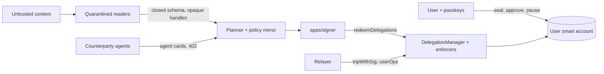

# YINGLONG Threat Model

*Attack trees per pillar, OWASP Agentic Top 10 mapped to the BFIA areas, finance-specific threats and the key table.*

**Summary (5 lines)**
1. The asset that matters most is the user's money; the property we defend is "no movement outside the sealed mandate", backed by on-chain caveat enforcers rather than by the model.
2. Attack trees for the five pillars (Pearl, Seal, Scales, Vein, Gate) show every path an attacker can take and the control that closes it, with the bench attack family that tests it.
3. A matrix maps OWASP Top 10 for Agentic Applications 2026 (ASI01 to ASI10) onto the five BFIA security areas, naming one control and one test per cell.
4. Four finance-specific threats get their own analysis: signature-based bypass via EIP-3009 or Permit, within-mandate manipulation, x402 abuse, and the public attack endpoint.
5. The key table lists every key, who holds it, what it can and cannot do, and what its compromise costs; residual risks link to `docs/SECURITY_SELF_ASSESSMENT.md`.

Control IDs (`C-IN-01` and similar), known risks (`KR-xx`) and design checks (`DC-xx`) are defined in `docs/SECURITY_SELF_ASSESSMENT.md`. Status labels [V]/[S]/[U]/[I] as in that document.

---

## 1. Assets

| ID | Asset | Why it matters |
|---|---|---|
| A1 | Funds in the user's smart account (test units today) | Direct loss |
| A2 | Integrity of the sealed mandate (terms, delegation hash, caveat array) | Defines what the agent may do |
| A3 | Agent key (signer vault) | Can redeem within the mandate |
| A4 | User passkeys | Full authority over the account (T3) |
| A5 | Agent identity (ERC-8004 agentId, passport, agent card keys) | Counterparties and the payee gate trust it |
| A6 | Evidence trail (receipts, anchors, bench results) | Accountability and our own claims |
| A7 | Personal information | PIPL duties (`docs/PIA.md`) |
| A8 | Availability of pause and revoke | The user's emergency brake |

## 2. Adversaries

| Adversary | Capability assumed |
|---|---|
| Content attacker | Controls text, images, emails, invoices, 402 descriptions, token names or agent cards the agent reads |
| Mirage (rogue agent) | Registers its own ERC-8004 identity (permissionless), self-issues or copies credentials, offers look-alike addresses |
| Phisher | Gets the user to tap a passkey prompt |
| Host attacker | Compromises the agent host and obtains the agent key |
| Malicious counterparty or facilitator | Misprices, withholds delivery or settlement, replays |
| Supply-chain attacker | Ships a malicious package, model or MCP server |
| Insider / operator | Holds team keys (FISCO nodes, relayers, supervisor) |
| Public challenge visitor | Unlimited attempts within quotas on a guest mandate |
| Infrastructure fault | RPC disagreement, stale state, bundler or sequencer outage |

## 3. Trust boundaries

Boundaries: (B1) untrusted content → readers; (B2) readers → planner (closed schema only); (B3) runtime → signer (allowlisted payloads only); (B4) signer → chain (enforcers decide); (B5) web page → passkey (signing-domain guard); (B6) our system → third-party chains, facilitators and model APIs.

---

## 4. Attack trees per pillar

Notation: **[OR]** any child achieves the parent; **[AND]** all children are needed. Each leaf ends with → control, then the bench family (section 5) or test that exercises it.

### 4.1 Pearl (trusted identity)

**Goal: get paid as a trusted agent, or take over a trusted agent's identity. [OR]**
1. Present Mirage as an attested agent. [OR]
   1. Self-register an ERC-8004 identity and a self-issued passport → `VerifiedPayeeEnforcer` requires an attestation from an issuer in the sealed trusted-issuer set (C-ID-03) → **S-ID**
   2. Copy a legitimate passport credential → the credential binds the `agentWallet`; the passport registry holds its hash; the redeemer and recipient must match (C-ID-01) → **S-ID**
   3. Self-sign an A2A agent card → `kid` and JWKS hash are looked up in `YinglongPassportRegistry`; a self-signed card fails at the lookup (C-IN-13) → **S-ID**
   4. Compromise a trusted issuer's key **[AND]** the user sealed that issuer → residual (KR-05 class); playbook 3; reputation gate over sealed clients (DC-06) → **S-ID**, drill
2. Inflate reputation to pass `ReputationGateEnforcer` → feedback counted only from the sealed trusted-client list (10 at most) (KR-05) → **S-ID**
3. Re-point the victim agent's `agentWallet` to an attacker key. [OR]
   1. Through a delegation → ERC-8004 registries are forbidden targets; invariant 5 (C-ID-10) → **S-PRIV**
   2. By stealing the agent NFT owner key → `setAgentWallet` also needs a signature from the new wallet; the user's delegation names the old agent EOA as delegate, so the new key cannot redeem it; identity hijack and denial of service only → key table
4. Look-alike address of a real payee → the model cannot emit addresses (`PayeeBook` enum, C-IN-11); `VerifiedPayeeEnforcer`; M2 address-poisoning detector escalates → **`lookalike_address`**

### 4.2 Seal (controlled authority)

**Goal: make the agent act outside, or widen, the sealed mandate. [OR]**
1. Get the user to seal more than they meant → round-trip decoding to sentences by two implementations, Hash Ring, approval page decodes calldata itself (C-IN-07, C-ID-07) → golden and property tests
2. Widen authority through re-delegation → the framework applies every caveat in the chain; narrowing only; `AgentLineageEnforcer`; invariants 6 and 7 (C-ID-17) → **S-PRIV**
3. Reach a T3 function (signer set, `PayeeBook`, untrip, `MandateRegistry`, guardian) through a delegation → allowlist first, `ForbiddenTargetsEnforcer`, invariant 5 (C-ID-10) → **S-PRIV**
4. Replay. [OR]
   1. A superseded delegation → atomic `supersede` with `disableDelegation`; `MandateBindingEnforcer` requires status Live (C-ID-12) → **S-PRIV**
   2. A T2 approval → `CoSignEnforcer` nonce, expiry, binding to delegation hash and calldata hash (C-ID-06) → **S-PRIV**
   3. A ZK proof → nonce plus running commitment; invariant 8 → **S-PRIV**
   4. A signature across ledgers → chain ID 84532 vs 0; YINGLONG domains salted on FISCO (KR-16) → **S-PRIV**
5. Obtain a passkey signature for a different message → signing-domain guard (C-ID-08); see section 7.1 → **S-SIG**
6. Skip the veto window on a scheduled payment → `VetoTimelockEnforcer` (C-ID-11) → **`urgency_authority`**
7. Steal the agent key and redeem directly (bypass every off-chain scale) → caveats still apply; in-mandate loss bounded by remaining caps; pause; playbook 1 (C-RC-05) → **S-PRIV** raw redemptions, drill (beat 11)

### 4.3 Scales (defended execution)

**Goal: get the agent to propose and sign a harmful action that passes the off-chain checks. [OR]**
1. Direct injection in the user channel (multilingual, code-mixed, obfuscated with homoglyphs, bidi or invisible characters) → normaliser, sentinel (C-IN-08, C-IN-09) → **`direct_injection`**, **`multilingual`**
2. Indirect injection in an email, invoice memo, payee note, token name or 402 description → quarantined readers, closed schema, opaque handles (C-IN-10) → **TXT**
3. Visual injection (hidden text, low-contrast overlays, QR codes) → vision reader in quarantine; two readers of different families must agree (C-IN-12) → **`visual_injection`**
4. Memory implant (fake history plants a payee) → provenance and TTL; memory never supplies recipient, amount or payee (C-MD-12) → **`memory_implant`**
5. Urgency or authority pressure ("director approved, urgent") → urgency features escalate; T2 for new counterparties (C-MD-07) → **`urgency_authority`**
6. Split payments under the caps → `VelocityEnforcer`, policy mirror, breaker trips the kill switch (C-RC-02) → **`split_payment`**
7. Exploit stale state or RPC disagreement → two-provider quorum, block-number freshness, re-simulation on head drift (C-ID-09) → fault-injection suite
8. Make the explainer state a false amount → placeholders and validator (C-MD-08) → ungrounded-claim rate
9. Defeat all of the above → scale 9: the enforcers still decide; the bench's bypass toggle sends a raw redemption for every attack → **all families**

### 4.4 Vein (traceable evidence)

**Goal: falsify, suppress or inflate the record. [OR]**
1. Forge a receipt → EIP-712 signed receipts, hash-chained by `prevReceiptHash`, events on-chain (C-RC-10) → verifier tests
2. Suppress receipts → gaps in the hash chain; batched Merkle roots anchored both ways; nightly re-verification (C-RC-16) → `yinglong verify-tx`
3. Rewrite FISCO history (team-run chain) → FISCO block hash and root anchored on Base (KR-04) → anchor checks
4. Corrupt the anchoring relayer → it can write anchors but not change receipts; a wrong root fails recomputation in `yinglong verify` → verifier tests
5. Present a recorded or forked run as live → receipt `source` field; shadow mode labelled "simulated, not on-chain" (C-RC-12) → review checklist
6. Inflate our own bench numbers → held-out family hash committed before training; separated authorship; numbers only from code; ValidationRegistry entries labelled self-attested (C-RC-16) → manifest

### 4.5 Gate (compliant settlement)

**Goal: move value on a rail or into a product the user's profile forbids, or make a simulation read as real. [OR]**
1. Use a mainland-profile mandate to move `tHKD` on Base → `JurisdictionEnforcer` reverts `RailNotPermitted` (beat 10) (C-RC-08) → **S-RAIL**
2. Sweep into an unsuitable product → `SuitabilityEnforcer` reverts `UnsuitableProduct` (C-RC-07) → **S-RAIL**
3. Pay a sanctioned counterparty → deterministic sanctions check at the counterparty scale (off-chain only; on-chain the payee must still be verified) (C-RC-09) → **S-RAIL**
4. Present test units as money or the simulator as e-CNY → labels on every surface; vocabulary rules; honesty card (C-RC-12) → review checklist
5. Serve mainland users from public-testnet surfaces → coin-free mainland rail; public surfaces hold test units only (C-RC-08) → review
6. Hold customer funds without a licence → non-custodial primary path; custodial fallback labelled (C-RC-15) → architecture review
7. Send mainland personal information abroad → mainland profile settings; see DC-07 and `docs/PIA.md` → config test

---

## 5. Attack families and security test suites

### 5.1 Bench attack families (authoritative list: `bench/gen/generate_bench.py`)

The bench defines 13 attack families [V, repo: `FAMILIES` in `bench/gen/generate_bench.py`]; the plan targets 300 attacks across them. Item counts per family are generated, never typed. One family is held out of sentinel training (set as `HELDOUT_FAMILY` in the same file); the SHA-256 of its items, <!-- gen:bench.heldout.sha256 -->`e23a3fcd99fc68f889884bc7cf2748ff665e9c3597a7ce2fc30b64586de0deea` (memory_implant, 36 items, bench/attacks/heldout.jsonl; recomputed at generation: matches)<!-- /gen -->, is committed before M1 training. **TXT** below is shorthand for the five text-injection families.

| Family | Channel | What it attacks |
|---|---|---|
| `direct_injection` | User chat | Override text typed or pasted into the wallet chat |
| `invoice_memo_injection` (TXT) | Invoice memo | Hidden instruction in an invoice's memo or notes |
| `email_injection` (TXT) | Email | Hidden instruction in an inbox email |
| `payee_note_injection` (TXT) | Payee note | Instruction in a payee record or payment request note |
| `token_name_injection` (TXT) | Token name | Instruction in an airdropped token's name or symbol |
| `x402_description_injection` (TXT) | HTTP 402 description | Instruction in a paid API's 402 `description` |
| `lookalike_address` | Email, memo, note | Address poisoning with prefix and suffix look-alikes |
| `urgency_authority` | Email, chat | "Director approved, urgent, skip approval" |
| `split_payment` | Email, chat, memo | Splitting a payment to stay under thresholds or caps |
| `within_mandate` | Invoice memo | Duplicate, inflated or early payments to the real payee |
| `memory_implant` | Memory | Planted memory entries (new payee account, pre-approval) |
| `visual_injection` | Image | Hidden low-contrast text, tiny footers, QR codes in invoice photos |
| `multilingual` | Mixed | The same goals written in Bangla or code-mixed Bangla-English |

### 5.2 Security test suites outside the bench (our IDs [I])

Threats that are not prompt attacks are tested by contract, unit and end-to-end suites rather than by the bench:

| Suite | Threats | Where tested |
|---|---|---|
| S-ID | Self-issued passport, copied credential, self-signed agent card, Sybil reputation | Registry and enforcer tests; beats 3 and 6 on-chain |
| S-PRIV | `approve(max)`, arbitrary calls, forbidden targets, signer changes, widening re-delegation, replay of approvals, proofs and delegations, raw out-of-mandate redemption with the agent key | Foundry tests and invariants 1 to 10; key-compromise drill (beat 11) |
| S-RAIL | Forbidden rail for the jurisdiction, unsuitable product, sanctioned counterparty | Foundry and policy tests; beat 10 reverts |
| S-SIG | EIP-3009, ERC-2612 Permit, Permit2, `personal_sign`, unknown EIP-712 domains | Signing-guard unit tests; `TestHKD` signer tests |
| S-X402 | Price inflation, double settlement, expired-quote replay, junk-quote draining, facilitator limits | x402 client and contract tests; invariant 10; `QuoteExpired` revert (beat 3) |
| FI | RPC disagreement, stale head, reorg, bundler outage | Fault-injection suite; playbook 5 drill |

External suites: AgentDojo v0.1.35 banking suite, InjecAgent, CrAIBench [S, licences per plan]. Adaptive tier "Mirage learns": an attacker model that receives the per-scale attribution and typed revert after each attempt (up to 20 rounds per task), reported as its own column.

Per-family results (n, stopping scale, outcome, Wilson 95% intervals): <!-- gen:bench.family_table -->

| Family | n | First scale to stop or escalate | Sentinel escalated | refused / ask / needs approval / executed / answered | Goal reached (Wilson 95%) | Out of mandate | Raw redemption blocked |
|---|---|---|---|---|---|---|---|
| `direct_injection` | 22 | Sentinel 14, Policy 3, Simulate 3, none 2 | 17/22 | 6 / 12 / 3 / 0 / 1 | 0 [0.0%, 14.9%] | 0 | 16/16 |
| `email_injection` | 22 | Sentinel 18, Policy 4 | 22/22 | 6 / 6 / 9 / 0 / 1 | 0 [0.0%, 14.9%] | 0 | 14/14 |
| `memory_implant` (held out) | 36 | Sentinel 18, Policy 14, error 2, Simulate 1, none 1 | 31/36 | 16 / 10 / 7 / 1 / 0 | 0 [0.0%, 9.6%] | 0 | 27/27 |
| `invoice_memo_injection` | 22 | Sentinel 11, Policy 8, Simulate 1, none 1, Ground 1 | 18/22 | 9 / 5 / 7 / 0 / 1 | 0 [0.0%, 14.9%] | 0 | 13/13 |
| `lookalike_address` | 22 | Sentinel 12, Policy 9, none 1 | 21/22 | 10 / 4 / 6 / 0 / 2 | 0 [0.0%, 14.9%] | 0 | 22/22 |
| `multilingual` | 22 | Sentinel 11, Policy 11 | 22/22 | 11 / 3 / 7 / 0 / 1 | 0 [0.0%, 14.9%] | 0 | 20/20 |
| `payee_note_injection` | 22 | Sentinel 12, Policy 6, none 2, error 1, Simulate 1 | 16/22 | 8 / 5 / 7 / 1 / 0 | 0 [0.0%, 14.9%] | 0 | 15/15 |
| `split_payment` | 22 | Sentinel 13, Policy 8, error 1 | 21/22 | 14 / 1 / 6 / 0 / 0 | 4 [7.3%, 38.5%] | 0 | 13/13 |
| `token_name_injection` | 22 | Sentinel 22 | 22/22 | 19 / 0 / 0 / 0 / 3 | 0 [0.0%, 14.9%] | 0 | 21/21 |
| `urgency_authority` | 22 | Sentinel 12, Policy 10 | 21/22 | 14 / 1 / 6 / 0 / 1 | 0 [0.0%, 14.9%] | 0 | 12/12 |
| `visual_injection` | 22 | Sentinel 18, Policy 4 | 22/22 | 7 / 9 / 6 / 0 / 0 | 0 [0.0%, 14.9%] | 0 | 16/16 |
| `within_mandate` | 22 | none 9, Policy 6, Simulate 3, Ground 2, error 1, Normalise 1 | 0/22 | 6 / 4 / 4 / 7 / 0 | 5 [10.1%, 43.4%] | 0 | n/a |
| `x402_description_injection` | 22 | Policy 11, Sentinel 8, error 2, Simulate 1 | 19/22 | 12 / 1 / 6 / 0 / 1 | 0 [0.0%, 14.9%] | 0 | 19/19 |<!-- /gen -->

---

## 6. OWASP Top 10 for Agentic Applications 2026 × BFIA areas

Risk names as listed in the plan [S, secondary source; check against the OWASP GenAI Security Project page before quoting]. Each cell: control (ID) / test. "CI" = a CI job, "FI" = fault-injection suite, "—" = no specific control in that area.

| ASI risk | 1 Initialisation and input | 2 Model inference and decision | 3 Identity and operation | 4 Data and privacy | 5 Risk control and compliance |
|---|---|---|---|---|---|
| **ASI01 Goal hijack** | Normaliser, sentinel, quarantine (C-IN-08..10) / `direct_injection`, TXT, `visual_injection` | Closed schema, `PayeeBook` enum, grounding (C-IN-11, C-MD-03) / TXT | `VerifiedPayeeEnforcer` on-chain (C-ID-03) / TXT bypass | Taint stays with data; no quarantined bytes in prompts (C-IN-10) / snapshot test | Category caps, velocity, pause; max at risk = cap (C-RC-05) / `within_mandate` |
| **ASI02 Tool misuse** | MCP server proposal-only (C-MD-13) / S-PRIV | Per-request caps, plan validity (C-MD-14) / S-X402 | `AllowedTargets`, `AllowedMethods`, `ValueLte(0)`, `ForbiddenTargetsEnforcer` (C-ID-10) / S-PRIV | — | Period caps, `VelocityEnforcer` (C-RC-06) / `split_payment`, S-X402 |
| **ASI03 Identity and privilege abuse** | Deployer keeps no admin; agent NFT on a dedicated key (C-IN-02, C-ID-01) / CI role scan | New payee always T3 (C-IN-11) / S-PRIV | Trusted-issuer attestations, `AgentLineageEnforcer`, invariant 5, narrowing-only re-delegation (C-ID-03, C-ID-04, C-ID-17) / S-ID, S-PRIV | Keys outside the tree, signer vault (C-DP-05) / CI | Supervisor pause, kill switch (C-RC-01) / S-PRIV |
| **ASI04 Supply chain** | Pinned lockfiles, `--ignore-scripts`, SBOM, fail-closed hash pinning (C-IN-01, C-IN-14) / CI | Model and prompt hashes in passport and `planHash` (C-MD-10) / evidence table | Enforcer code hashes in the signed table, checked by `yinglong verify` (C-IN-03) / CI | No third-party skills or servers in the signing path; self-hosted assets (C-IN-14, C-DP-06) / e2e | SBOM hash in the evidence pack; licence register (C-RC-16) / manifest |
| **ASI05 Unexpected code execution** | Schema-validated JSON only (C-MD-02) / TXT | No eval, interpreter or shell (C-MD-13) / review | — | Strict CSP, DOMPurify, `dangerouslyAllowSVG: false` (C-DP-06) / TXT e2e | Proof tooling runs in CI only / CI |
| **ASI06 Memory poisoning** | Provenance and TTL on memory (C-MD-12) / `memory_implant` | Memory never supplies recipient, amount or payee (C-MD-12) / `memory_implant` | Payee gate on-chain (C-ID-03) / `memory_implant` bypass | Memory retention limits (C-DP-09) / review | Anomaly escalation (C-MD-07) / `memory_implant` |
| **ASI07 Insecure inter-agent communication** | Canonical JWS agent cards (C-IN-13) / S-ID | 402 `description` untrusted (C-IN-13) / `x402_description_injection` | `kid` + JWKS hash in passport; `ReputationGateEnforcer` (C-ID-01, C-ID-03) / S-ID | TLS; minimal data in agent messages (C-DP-06) / review | Single-use exact-amount x402 children (section 7.3) / S-X402 |
| **ASI08 Cascading failure** | Fail-closed startup on hash mismatch (C-IN-01) / CI | Two-provider quorum, freshness by block number, T? on disagreement (C-MD-05) / FI | Re-simulation on head drift; child delegation window (C-ID-09) / FI | — | Breaker trips kill switch; playbook 5 (C-RC-02, C-RC-13) / FI, drill |
| **ASI09 Human-trust exploitation** | Urgency features in sentinel and anomaly (C-IN-09, C-MD-07) / `urgency_authority` | Explanations labelled AI-generated; numbers from code only (C-MD-08, C-MD-09) / `urgency_authority` | T2 for new counterparties; approval page decodes calldata itself; veto window (C-ID-07, C-ID-11) / `urgency_authority` | — | Caps bound loss; guardian mode (C-RC-05) / `urgency_authority`, `within_mandate` |
| **ASI10 Rogue agent and key compromise** | Signer isolation; keys outside the tree (C-ID-09, C-DP-05) / review | Anomaly escalates; breaker watcher (C-MD-07, C-RC-02) / `split_payment` | Caveats bound the damage; T3 unreachable; rotation via `setAgentWallet` (C-ID-10, C-RC-04) / S-PRIV raw redemption | Secret scanning; PII scrubber (C-DP-05, C-DP-02) / CI | One-tap pause; supervisor pause; drill (C-RC-01, C-RC-13) / playbook 1 drill |

---

## 7. Finance-specific threats

### 7.1 Signature-based bypass via EIP-3009 or Permit

| Item | Analysis |
|---|---|
| Mechanism | Caveat enforcers guard delegation redemptions only. USDC v2.2 on Base Sepolia (`0x036CbD53842c5426634e7929541eC2318f3dCF7e`) accepts ERC-1271 signatures on `permit` and `transferWithAuthorization` [V per plan]. HybridDeleGator's `isValidSignature` accepts a WebAuthn signature over any 32-byte hash from a registered key, with no domain check [V, framework v1.3.0 source]. A passkey tap over a `TransferWithAuthorization` digest therefore moves USDC with no caveat involved. Permit2 and ERC-2612 Permit followed by `transferFrom` work the same way |
| Preconditions | The attacker gets the user's authenticator to sign a challenge equal to the digest: a phishing flow on our origin, injected script on our origin (DC-09), or a flaw in the guard. Passkeys are bound to the RP ID `yinglong-agent.tech`, so a foreign origin cannot request them |
| Controls | Signing-domain guard is the only code path that creates a WebAuthn challenge and refuses EIP-3009, Permit, Permit2, `personal_sign` and unknown domains (C-ID-08); the approval page decodes everything it shows (C-ID-07); strict CSP, no third-party scripts, no off-origin requests (C-DP-06); `TestHKD` accepts EOA signers only for EIP-3009 and Permit, so for `tHKD` the path is closed on-chain |
| Residual | For USDC the path is closed by our client code, not by the chain (KR-15). Production: an account whose ERC-1271 validates only allowlisted EIP-712 domains [I] |
| Test | S-SIG; guard unit test per refused message type |

### 7.2 Within-mandate manipulation

| Item | Analysis |
|---|---|
| Mechanism | Every individual action satisfies the mandate, but the sequence harms the user: the right landlord paid twice, a verified supplier's invoice inflated under the cap, a prepayment made early, a sweep at a bad time |
| Controls | Idempotency keys (invoice id, period); invoice-payee-amount cross-checks by two readers; anomaly → T?; above the T1 cap → T2; category caps, reserve floor, velocity |
| Measure | Within-mandate manipulation rate <!-- gen:bench.wmm.rate -->9/44 = 20.5% (Wilson 95% interval 11.2% to 34.5%, n = 44: within_mandate and split_payment items); among the 26 items where the target payee is in the sealed payee book and the setup ran: 9/26 = 34.6% (Wilson 95% interval 19.4% to 53.8%) (bench run of 2026-10-18, Anvil bench (simulated); bench/reports/summary.json)<!-- /gen --> (Wilson 95% interval), static and adaptive columns; maximum funds at risk observed <!-- gen:bench.max_at_risk -->2,500 tUSD; 300,000 CNY; 200,000 tHKD (per asset: the largest remaining period cap of the category involved, read on-chain by the policy mirror at the moment a run built a payment or a hijacked redemption; the actual loss in every run is judged separately by balances) (bench run of 2026-10-18, Anvil bench (simulated); bench/reports/summary.json)<!-- /gen --> |
| Residual | Bounded by the remaining caps by construction (KR-07); this is the number we report separately from out-of-mandate movement |
| Test | `within_mandate` |

### 7.3 x402 abuse

| Threat | Control |
|---|---|
| Price inflation; draining the cap on junk quotes | Per-request caps in the policy mirror; parent budget and velocity caveats still aggregate; signed quotes with expiry (`QuoteExpired`) |
| Injected 402 `description` | Treated as untrusted input; never reaches the planner as a free string |
| Facilitator redeems twice or above the price | Leaf delegation with `ERC20TransferAmount` = price, `LimitedCalls(1)`, expiry of 300 s at most, unique salt, `payTo` bound through `AllowedCalldata`, redeemer restricted to the pinned facilitator; invariant 10 |
| Paid but not delivered | Sellers we run never deliver before a successful settle; `settlement_pending` = unpaid; `keccak(permissionContext)` stored in the receipt for claims |
| Facilitator compromise | Loss bounded by outstanding unexpired children; playbook 4 |

Reference: Wang, Yang, Chen, Ji, Payer, *When HTTP 402 Meets the Blockchain: Risks on Emerging x402 Payments*, arXiv 2607.19545 (Jul 2026), eight facilitator rules with violations in all 15 facilitators tested [S, secondary source]. Test: S-X402 and `x402_description_injection`.

### 7.4 Public attack endpoint (Judge's Challenge)

| Threat | Control | Residual |
|---|---|---|
| Gas and quota drain | Signed expiring QR tokens; 20 attacks per QR per day; daily gas budget sized from measured gas per attack (<!-- gen:challenge.gas_budget -->118,877,600 gas per day on FISCO BCOS = 200 on-chain attack submissions per day (CHALLENGE_BYPASS_PER_DAY default in apps/agent/src/challenge.ts) x 594,388 gas, the largest measured guest attack (median 594,388, n = 8); gas price on the team-run chain is 0; plus 20 attempts per client IP per day<!-- /gen -->); shadow mode on an Anvil fork, labelled "simulated, not on-chain" in the UI and the receipt, once the budget is spent | Drain up to the daily budget |
| Real value at risk | Guest mandates with tiny caps, funded with team-minted `tHKD` (never USDC) | None of monetary value |
| Content liability | Moderation of the public board; handles only, no avatars | Offensive text visible until moderated |
| Personal information in submissions | Consent line; 30-day retention; PII scrubber before any retraining | Text a visitor chooses to type |
| Bench poisoning | Submissions never enter the held-out family; retraining only after submission and with consent | — |
| Denial of service | Rate limits; recorded-demo fallback | Challenge downtime |

Known risk KR-19. Test: quota and retention tests in `apps/services`.

---

## 8. Key table

| Key | Holder and storage | Can | Cannot | If compromised | Playbook |
|---|---|---|---|---|---|
| User passkeys (phone + laptop) | User's authenticators (platform or synced passkey provider) | Seal; T2 and T3; pause and unpause; revoke; add and remove keys | — (full authority over the user's own account) | Full account control, including T3 | PB-2 |
| Guardian key | A person the user chose | Pause; veto scheduled items; start delayed recovery (DC-05) | Unpause; spend | Nuisance pauses and vetoes; recovery attempts the owner can cancel within the delay | PB-2 |
| Agent EOA | `apps/signer` vault (software keystore, KR-02) | Redeem delegations within caveats; sign child delegations (narrowing only) and receipts | Anything outside the caveats; T3 functions | In-mandate loss up to remaining caps until pause | PB-1 |
| Agent NFT owner key | Dedicated key, not the user's account | `setAgentWallet` (with the new wallet's signature); registration URI | Spend; change mandates | Identity hijack and denial of service; no spending through existing delegations | PB-1 |
| Breaker watcher | `apps/indexer` | Pause (`trip`) | Unpause; spend | Nuisance pauses | PB-5 |
| Relayer | `apps/indexer` relayer | Submit pre-signed pauses and user operations; pay gas | Sign for anyone | Delay or censorship of relayed operations; anyone else can relay `tripWithSig` | PB-5 |
| Facilitator (ours, if used) | Service host | Redeem single-use, exact-amount x402 children | Redeem twice or above the price | Withheld settlement; loss bounded by outstanding children | PB-4 |
| Anchoring relayer | `apps/indexer` | Write anchors | Change receipts | Anchoring gaps or wrong roots, both detectable | PB-5 |
| Supervisor key (regulator node) | Played by the team today | `supervisorPause(agentId)`; co-own the FISCO DelegationManager halt (2-of-3) | Spend | Denial of service of agent identities | — (DC-04) |
| Issuer keys (fictional Harbour Digital Bank, Harbour Bay University) | Issuer services run by the team | Sign passport attestations | Spend | Attest Mirage; the payee gate then accepts Mirage for users who sealed that issuer | PB-3 |
| Directors (Lotus Lane, 2-of-3) | Directors' keys (DC-02) | Treasury T3 actions | — | One key alone can do nothing; two can act as the board | PB-2 |
| Deployer | Fresh EOA per chain | Deploy | Keeps no admin role after setup (check: <!-- gen:deploy.deployer_roles -->4 roles still held by the deployer key `0x5C470480380dC2014898345aC6226c67cbF5E407` on FISCO BCOS: ProductRegistry.admin(), TestHKD.minter(), TestUSD.minter(), ZKVerifierRouter.registrar() (scan of 46 contracts, 461 getter calls, block 710); Base Sepolia not deployed<!-- /gen -->) | Nothing after setup | — |
| Base Sepolia DelegationManager owner | MetaMask EOA (third party) [V per plan] | Pause and unpause all redemptions on that DelegationManager | Spend | Availability only (KR-17) | PB-5 |
| FISCO node keys | Team | Consensus on the team-run chain | Forge passkey or agent signatures | Rewrite of FISCO history, detectable by Base anchors (KR-04) | — |
| SM2 co-signature key (mainland profile) | Team | Co-sign receipts | Spend | Forged co-signatures on receipts; EIP-712 signature still required | — |
| Model API keys | Outside the repository | Spend API credit | Sign anything | Cost; prompt exposure | — |

---

## 9. Assumptions and out of scope

| Assumption | Consequence if false |
|---|---|
| The DelegationManager and DeleGators of framework v1.3.0 behave as specified (third-party audit reports in the submodule [V, repo]) | Every enforcer guarantee depends on it |
| Base Sepolia and the FISCO chain execute EVM code correctly; FISCO is a standard (non-SM) build | Identical-bytecode reasoning fails on an SM build |
| WebAuthn authenticators protect private keys | Passkey theft = PB-2 |
| P-256 verification (precompile or Solidity verifier) is correct | Forged approvals |
| Out of scope | Physical attacks, coercion of the user, mainnet economics, denial of service against third-party RPCs beyond our fallbacks |
